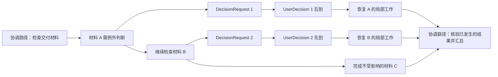

# DecisionRequest 驱动的局部续行与分支调度

| 项 | 内容 |
| --- | --- |
| 状态 | 2026-10-30；产品集成仍为设计提案；锁定 Pi 源码的 258 项上游测试与 6 项机制实验已通过，不代表完整 Airic Work 合同已验证 |
| 上游 | [PRD](prd.md)、[Worker Skill](../backend/skills/airic-work-worker/SKILL.md)、[运行环境设计](worker-runtime-design.md) |
| 本轮确定的行为 | 遇到问题只暂停受影响部分；一次运行可积累多个 DecisionRequest；用户分别回应后，相关工作能带着提问时的上下文继续 |
| 本文建议 | 一个 Execution / Session 内保留多个上下文分支，按需建立局部续行记录；首版串行调度，后续再验证并发 |
| Pi 落地依据 | [Pi Durable 能力核实与具体接入](pi-durable-capability-review.md)；固定 commit、API、原生 Task/ownership 方案与可复现实验 |
| 评审边界 | 以下内部记录、默认路由与调度策略是可评审方案，不是已发布的端口或产品实体；本轮不修改实现代码 |

## 1. 执行模型需要纠正的地方

“一个 Execution 对应一个 Session”约束历史和资源的归属，不约束模型上下文只能有一条时间线。一个 Session 可以保存多个 Conversation、提问锚点、输入路由和工具调用；同一 Execution 仍只有同一个归属人、固定 OM 和 Workspace。

两种顺序必须区分：Session 的提交顺序可以是线性的；工作之间的依赖和上下文继承可以构成有向图。不能将列表显示的时间先后当成每个分支都看见了全部先前事件，也不能用 root 是否空闲代表整个 Execution 是否空闲。

Decision Context 支持人理解问题；恢复 Agent 则还需要当时可见的消息、方法版本、工具返回和局部未完成事项。不能拿 Decision Brief 或一段模型摘要替代可定位的原始上下文。

## 2. 方案比较与建议

| 方案 | 优点 | 对本需求的限制 |
| --- | --- | --- |
| 一条 Conversation，回答统一追加末尾 | 交付与排序简单 | 要从很长的后续历史里重建局部问题；容易重复扫描或把不同问题混到一起 |
| 每条 UserDecision 都从提问点 fork | 提问现场清楚 | 同一工作有多个问题时会重复启动；更正可能从旧现场重复写入；仍缺少分支结果协调 |
| 一开始分解完整任务树并并行运行 | 可独立处理多个工作范围 | 分解粒度、依赖、并发写入和汇合都需预先管理；没有必要要求所有委托先生成完整任务图 |
| **按需建立局部续行，保留上下文分支** | 原路径继续其他工作；受阻部分有独立恢复位置；可以逐步发展成多任务 | 需要持久续行记录、精确输入路由、工作范围归属及 Execution 级调度 |

建议第四种。执行从一个协调 Conversation 开始，遇到受阻部分时将其交给局部续行记录，继续不依赖它的工作。首次收到相关回答时才按需建立对应 Conversation；后续回答沿用该局部工作的当前 Conversation，不为每条回答重新复制整段工作。

这允许逻辑上的多任务与非线性路径，首版无需同时运行多个模型或允许并发写 Workspace。若 OM 已明确多个可独立工作范围，也可以主动建立局部续行；不把“先分解完整任务树”设为启动前置要求。

## 3. 示例：多个问题与独立进展

问题 2 先回答，就先推进 B，不等待问题 1；A、B 的回答不重复执行 C。若 A 的同一动作还需要问题 3，问题 1 的回答先用于该局部工作的重新判断；能做的先做，仍有依赖的动作继续等待。不是每条回答都意味着可以立即执行业务写入。

## 4. 最小内部记录

这些是运行控制合同中的技术记录，不增加用户可分配的 Task、Worker 角色或独立 Session；具体存储结构待端口评审后确定。

| 记录 | 必须保存的内容 | 不承担的职责 |
| --- | --- | --- |
| 局部续行记录 `Continuation` | continuationId、executionId/sessionId、来源 Conversation、局部工作范围、恢复指示、依赖的 DecisionRequest、当前 Conversation、修订与调度状态 | 不记录外部业务完成事实，不自动分解业务工作 |
| 提问来源 `DecisionOrigin` | 完整 DecisionRequest ID、工具调用身份、原 Conversation、提问记录位置、当时 Context 修订、局部续行标识、可用的安全恢复锚点 | 不替代面向人的 Decision Context，不保存隐藏思考链 |
| 输入接收与路由记录 | inputId、sequence、原 UserDecision/Steering Input 关联、目标续行、目标 Conversation、内容摘要、接收/调度位置 | 不把接收或处理等同于 Agent 专业采纳 |
| 准入与进展记录 | 当前代次、活动槽、输入到原生 Task 的映射、人工依赖、可定位的完成摘要与调用引用 | 不复制 Pi 的任务状态/就绪队列，不维护第二份业务结果 |

建议在 Session 中持久保存续行、路由、调度记录，和相应 Conversation 创建一起提交；应用库只保存 DecisionRequest 等现有产品控制事实及必要关联。派生列表可索引，但不能成为另一个权威调度库。涉及权限、归属和跨存储提交的规则由 Application 拥有，Pi Document 类型只留在适配器。

初始协调路径也有稳定的续行身份。一个 DecisionRequest 有一个主要续行目标；多个 DecisionRequest 可以指向同一个局部工作。其他工作需要依赖其结论时显式记录依赖，不能把一条 UserDecision 无差别广播成多次执行命令。

### 4.1 局部状态与产品状态分开

读取界面可描述局部工作是可运行、运行中、等待、完成、受阻或取消，但不另存一套与 Pi 竞争的任务状态机。Pi Task 的 pending/running/waiting/terminal 是实际执行事实；Continuation 只保存人工依赖、范围、上下文与关联。等待用户时不保留一个运行中的 Pi Task 或工具 Promise。

这些状态不是 Execution.phase，也不是 DecisionRequest.status。UserDecision 保存后请求已经 answered；局部工作仍可 waiting 或 blocked。Execution 无活动/就绪工作时可以 ended，仍保留未来可唤醒的续行记录。

### 4.2 工作范围必须交接

创建局部续行时，Worker 描述被阻塞的对象/范围、尚未完成的动作、依赖、相关操作引用，以及原路径可以继续什么。原路径将这部分标为已交接，不能又把同一待办当成自己的下一步。恢复分支只承担交接范围，不能照抄继承的“检查全部材料”指令重新开始。

同一局部工作再提问题时沿用 continuationId；有独立范围才新建。宿主能检查标识和归属，却不能仅凭自然语言证明两个业务范围互不重叠。串行化只防止同时运行，不保证语义上不会重复操作；还需业务工具的原操作身份、当前状态核验及实际场景验证。

### 4.3 拟定工具合同

`work_request_decision` 保留 question/options/context，并增加一个局部续行描述：

| 字段 | 语义 |
| --- | --- |
| `mode` | `defer_part`：把当前工作的一个受阻部分交接出去，当前路径继续；`wait_current`：当前局部工作已无独立动作，提出问题后让出 |
| `continuationId` | 已有局部工作时引用它；首次 defer 由宿主按稳定工具调用身份创建并返回，模型不生成技术身份 |
| `scope` / `resumeInstruction` | 等待的对象与工作范围，以及回答后需要继续的动作；不是复制整个 Execution instruction |
| `relatedDecisionRequestIds` | 同一工作已有的明确依赖；宿主校验这些请求属于当前 Execution，不能引用其他用户工作 |

可信调用上下文仍由宿主注入，原 Conversation、generation 和 callId 不接受模型覆盖。局部续行身份、提问来源绑定与 request ID 一起返回；该入口不提供任意 fork API。

`work_yield` 只作用于当前片段所属的局部工作，描述还有可做部分、等待哪些依赖或已完成，以及进展/操作引用。不能用它替其他分支宣布完成，或替用户提交 UserDecision。新记录先成为待准备，只有锚点就绪且依赖输入可用才进入 ready。

依赖采用明确标识，不从“Execution 里还有多少 pending”推导。显式自等待或依赖环显示为 blocked 并交回协调处理，不能让调度器无限唤醒。

## 5. 提问锚点：保留上下文，不复制副作用

### 5.1 为什么不能随便选一个 entryId

恢复点至少要包含已提交的提问调用及其返回，使新上下文知道原 DecisionRequest 已创建。截在调用之前可能让模型再次提问；截在一组工具调用中间可能缺少同轮其他返回。上下文 fork 也不会复制执行中的工具、暂停某个业务事务，或替我们回滚外部状态。

建议将两个位置分开保存：精确的提问来源位置，以及**该轮工具均已终结后的安全上下文位置**。若一轮提出多个请求，它们可以共用安全位置，各自仍保留局部范围和请求来源。锚点就绪后，原路径才继续下一轮模型工作。

### 5.2 提问与锚点固化流程

1. Runtime 在 Session 固定原 toolCallId、来源 Conversation、局部范围和稳定命令键，创建待绑定的来源记录。
2. 入口经 Application 原子创建 DecisionRequest；重放同键返回原请求。
3. 将真实请求 ID 绑定回原来源，正常返回工具结果，不等待用户。
4. 正常注册工具统一返回 `control.terminate: true`，由 Pi 在本轮结果提交后终结当前 run。持久的 `aw.run-slice` 任务随后进入 finalize，在 Session commit 中固化安全锚点并更新来源，再安排后续片段。
5. 原路径继续处理不受影响的部分。用户回答可先保存；若锚点尚未固化，相关续行等待准备完成，其已回答事实不受影响。

`afterTools` 是 observer，抛错后会报告并继续，不能作为可靠写入门禁；实验 P05 已证实这一点。可靠顺序由 run-slice 的原生 checkpoint phases 保持。`terminate` 要求同轮所有工具结果都同意，且终结记录的 answer 不一定是最后一个工具结果；具体适配和异常轮限制见[能力核实第 5—6 节](pi-durable-capability-review.md#5-基于原生任务的串行片段方案)。

请求已保存、锚点未完成时进程崩溃，恢复用原调用键找回请求再补绑定。工具轮被取消时按原始调用与真实的终结记录固化可解释边界；不能为在途业务调用补造成功。实在无法构造协议有效的恢复点则只阻塞相关续行，显示具体原因；不得静默改用最新 root 上下文或创建重复请求。

### 5.3 历史现场与当前世界同时进入上下文

第一次恢复时：从安全锚点 fork → 装配原固定 Worker/OM → 限定局部工作范围 → 注入对应 UserDecision 与附件 → 补充锚点之后相关进展及最新指示 → 重新读取将要影响的业务对象 → 继续。

fork 恢复的是当时可见的指令/消息/工具结果，不是外部世界快照。Workspace 使用当前持久文件；业务系统也使用当前状态。发生变化时先检查回答的适用范围、对象版本和已有结果，不能按旧事实直接写入。仅有摘要的新增进展应可回到原记录核查；不能因为 fork 默认看不见兄弟分支，就假定那些操作没发生。

若 SDK 文档状态有 `current` / `asOf` / `initial` 等 fork 规则，需逐项明确：领域/局部恢复资料使用历史值，Session 级调度与接收事实使用当前共享值，活动运行状态不复制。不能用一种默认复制策略处理全部状态。

## 6. 回答的路由与幂等

### 6.1 首次回答与重复提交

UserDecision → 原 DecisionRequest → DecisionOrigin → Continuation，是主要路由链。完整 request 关系由控制记录查回，不根据回复文字相似度寻找恢复点。

Session 接收事务用 inputId 去重，并固定目标续行、候选分支创建身份和内容摘要。创建 Conversation 与绑定到 continuationId 应在同一 Session 提交中完成；随后再向该固定目标提交模型输入。崩溃重试只能查回原分支，不能每次 fork 新分支后依赖 Pi 的 requestId 去重。

Pi 原生 requestId 的去重范围不能替代 Execution 级 inputId 约束。`Runtime.accepted(sessionId, inputId)` 应查询 Session 级持久接收记录，而非只查 root 的 inbox。接收回执可以先于某条分支真正被调度；UI 仍区分已回答、已接收、处理进展和业务效果。

### 6.2 同一工作有多个问题

* 第一条相关回答唤醒局部工作，完成首次分支建立。
* 后续回答进入这个工作的**当前** Conversation，并带上各自原提问位置与 Context 修订；不再从旧点新开一份相同工作。
* 一条回答到达，只表示可以重新评价该工作。若动作确实依赖多条回答，则检查这些明确依赖后再执行；不能因还有其他无关请求 pending 而全局等待。
* 同时到达的回答按该续行内的持久序号处理，可以在同一片段读入，但保留每条原始来源。已处理输入集合仅用于防重复消费，不新增“判断采纳”状态。
* 更正回到现有工作上下文检查影响；已完成的工作也可重新评价。不能从最早提问点抹掉后续效果，更不能假装此前业务写入未发生。

### 6.3 一般消息与输入顺序

建议 Steering Input 默认交给协调路径，以 Execution 为作用范围；需要调整哪个局部工作由协调处理。不能仅投给最后活跃的分支，也不能自动当成回答。状态询问不需要唤醒所有等待分支；改变指示的消息则须进入受影响工作启动时的更新信息。

全局 sequence 用于记录接收顺序与控制消息边界；各 continuation 的可运行顺序不必等于全局完成顺序。同一局部工作的输入有序；彼此独立的回答不因另一请求未答而等待。

当前 `InputUseCases.dispatchInput` 用“前面所有输入均 delivered”作为硬条件，并在 Runtime 接收前物化文件。若早一条回答的文件失败，会挡住不相关回答。建议改为显式路由后按局部输入流和全局控制边界判断前置条件；不因单个附件失败阻塞全部工作，但取消及适用的指示变更不能被跨越。此变更属于需要评审的应用政策，不是 Pi 适配器可擅自跳过的顺序规则。

## 7. 首版调度：有分支，先串行

### 7.1 运行片段

Pi 原生支持多 Conversation 并发；首版每 Execution 最多激活一个模型/工具片段是资源准入政策。使用 `defineTask('aw.run-slice')` 的 acquire/submit/observe/finalize/report phases 和 Session 活动槽，槽占用时通过原生 `waiting/on:[TaskId]` 等待；不另写通用任务执行器。模型工具执行先配置 sequential。等待用户的工作只留依赖记录，不让父任务 join 挂在人上。

`work_yield` 记录局部结果、下一步和依赖，不是业务完成声明或 `finishExecution`。正常工具轮通过统一 wrapper 的 `control.terminate` 成为片段边界；run-slice.finalize 读取结构化意图，在真实终结后安排同一 Conversation 的内部续行，或把它留待新的用户输入。内部继续用独立 entry kind 和稳定 requestId，不伪装成 UserDecision。

Pi 调度原生 Task，Airic Work 只在准入处确定控制输入的先后和资源槽使用。具体公平准入仍须验证，不能把原生 Task 调度当成产品级延迟保证。人工依赖只有新输入改变时才创建工作，不按定时器轮询 DecisionRequest。实验 P06 已证明原生等待活动槽及 SQLite reopen 后恢复。

### 7.2 不虚构 Pi 的抢占能力

边界使用已核实的 `control.terminate`，而不是任意 observer 后暂停。SDK 在不可用工具或 Schema 错误路径生成的结果可能没有 terminate，混合轮也可能继续；不能宣称任意异常轮都严格只有一次模型请求。宿主限制模型/工具预算并如实记录失败；硬限制不能靠 fail-open hook 保证。

正常终止且不 reset 的机制已经过 P02 验证，统一 wrapper、异常轮收敛与公平性仍需生产适配合同测试。不承诺严格响应延迟，不用强行 abort 在途业务写入实现普通轮转。

逻辑分支可以先串行执行。真正并行需要另行解决 Workspace 写入、外部对象冲突、限额及跨分支输入可见性；为每个分支开容器也不会自动隔离外部业务效果。

### 7.3 汇合不是重放

局部工作完成时在 Session 保存显式完成记录：范围、已做事项、业务调用/对象引用、未确认项和还需协调的事项。宿主用稳定完成身份给协调路径追加一次通知，重复恢复不重复汇报。通知是继续判断的输入，不是“再做一遍这些动作”的命令。

不将两条 Conversation 的消息机械拼接为一条模型对话。协调路径按需读取分支原记录、核验当前业务状态，并处理剩余的跨范围工作；没有实际依赖就不设汇合屏障。Session 的统一查询视图负责展示各分支来源。

## 8. 整体运行、停止与共享资源

| 条件 | Execution 级行为 |
| --- | --- |
| 有 ready/running 续行或已接收待处理输入 | 仍有可运行工作；root 空闲不能触发整体结束 |
| 所有续行都 completed/waiting/blocked，且无在途工具或就绪输入 | 可以让出并按现有用例结束当前运行；保留未决请求和可恢复记录，展示真实阻碍 |
| 新回答/消息到达 ended | 在原 Session 中唤醒目标续行，沿用固定 OM 与 Workspace；不是对每个输入都创建新 Execution |
| 某分支失败 | 记录局部失败及依赖影响；独立工作可继续，不把它描述成整个业务任务失败 |
| Execution 取消 | 先设全局代次栅栏，停止所有 Conversation、队列及容器工具，保存撤回/未知事实；逐分支核验，不只 abort root |

首版共享一个 Workspace，可以用 `/workspace/work/<continuationId>/` 保存局部草稿，但目录约定不构成分支授权边界。可共享结果通过显式引用交接；不能恢复旧文件快照覆盖当前工作。需要修改同一文件时，串行执行后仍要核对当前内容。

一次新运行只增加 Execution 代次；切换分支不增加代次。未取消的崩溃恢复沿用原代次；取消后的旧工具不能换上新代次继续。新代次唤醒时先看所有旧分支的停止与未知结果，再接受新的有效动作。

SDK 的历史 parent 和任务 ownership 是两件事。具体采用官方 background anchor 模式：root 拥有后台 anchor task，anchor 拥有 fork Conversation，不挂到已返回的提问 tool task 下。Execution 取消先设代次栅栏，再调用 `root.abort(context, { background: true })` 跨后台边界，并检查容器退出。P04 已验证普通 abort 与全范围 abort 的差别；取消接纳后创建的新后台工作仍靠全局栅栏禁止，不假定 SDK 施加永久禁令。

### 8.1 整体结束的跨存储窗口

不能把“刚读到 Session 没有工作”作为不受保护的 finish 前置条件。建议采用短暂的收尾栅栏：

1. 唯一宿主持久确认所有分支无就绪/在途工作，Session 提交当前 generation 的 quiescing 标记及活动修订，暂停新调度与 Runtime 接收确认。
2. 这期间用户仍能在应用库提交回答和消息；它们保留 pending，Runtime 不返回虚假的已接收凭据。
3. Application 调用现有 finish 提交，原子校验当前代次、版本及无 pending 输入。有新输入则取消收尾，恢复接收并继续调度。
4. 提交 ended 后关闭旧调度/工具实例，保留 Session 内容；随后到达的输入按原续行用例确认旧运行退出并开启新代次。

Runtime 接收与收尾标记在同一 Session 提交线上互斥：标记之前已接收的输入必须被计入活动事实，标记之后不能抢先变成 delivered。这样才能连接 Session 级活动事实与应用库结束 CAS，而非假设两个存储可原子提交。

若进程在任一步崩溃，先读取应用 phase/generation 和 Session 收尾标记对账，再允许任何调度。运行中且存在新输入时撤销旧收尾；已 ended 则完成退出，不让旧代次自行恢复。此协议还需验证调用方重试、宿主锁及 stopped 的真实退出含义。

## 9. Session 与 Decision Episode 的读取

统一历史需要记录 conversationId、原 entryId、父分支/锚点、continuationId 和显式的 DecisionRequest/UserDecision 关联；Session 游标覆盖所有相关 Conversation，稳定去重，不仅扫描 root entries。提交顺序是展示顺序，不伪造上下文共享或专业因果。

Decision Episode 仍以一个 DecisionRequest 为中心，可定位其提出现场、回答，以及明确由它触发的续行记录；多个问题共用局部工作时只展示真实关联，不把全部后续操作都独占归因于某一回答。MCP 操作列表汇总所有分支，原 Session 记录不复制多份。

首版界面不必新增完整任务图编辑器；至少能从请求回到提出位置和后续处理，从操作回到对应分支，并明确 pending、已回答未运行、运行受阻等事实差别。它们是已有页面的读取需求，不新增用户角色。

## 10. Pi 候选映射与证据边界

实际验证基线为 v1.4.0 / `4a080252f06caf63a525d7873c5d94d3c23887e0`。已下载官方源码并运行选定测试与场景实验，记录见[Pi 能力核实](pi-durable-capability-review.md)。多 Conversation、fork、Session docs、terminate、Task waiting、SQLite reopen 及 background ownership 取消已有机制证据；完整应用集成与资源隔离仍待验证。

P03 已验证原子分支绑定与输入去重范围。应用仍须落实 Session 级 receipt 和跨存储恢复，不能用 Conversation requestId 替代全局路由；同一输入随机 fork 后再 submit 会重复执行。源码类型、方法和阶段的具体映射以能力核实文档为准。

映射原则：一个产品 Session 对应一个 Pi Session；内部多个 Conversation。Continuation 与调度记录可映射为宿主定义的 Session documents；entry/Conversation 的供应商 ID 不进入 Domain。若实际锁定版本能力不同，先调整外层映射并重跑合同，而不是改变产品行为。

## 11. Clean Architecture 修改计划

### 11.1 已确认行为、建议与边界

已确认的是局部受阻不阻塞独立工作、多个请求可同时待答、相关回答带原上下文恢复，以及现有回答/归属/Session 语义。本文建议的按需续行、首次 fork 后复用、串行片段调度、Steering 默认进入协调路径与局部输入流规则，需要作为下一阶段 WHAT 合同一起评审，再实施。

发现路径从 Worker 单 Conversation 限制出发，检查了 `DecisionUseCases` 的请求保存、`InputUseCases.dispatchInput` 的顺序与续行、`ExecutionUseCases` 的结束/取消、`QueryUseCases` 的历史、Runtime/History 端口。足够确认这些合同受影响；不为本设计修改正在独立开发的 Git/Methods、SQLite 实现、身份或前端代码。

| 行为负责人 / 层 | 需改变或验证的合同 | 当前可信程度 |
| --- | --- | --- |
| Domain：Execution / DecisionRequest | 保持一 Session/Workspace/owner/OM 和提交即 answered；不引入 Pi 类型 | 既有不变量可沿用 |
| Application：DecisionUseCases | 请求与稳定来源/局部续行关联；原键查回；锚点跨存储准备状态不影响回答事实 | 现有保存合同可信，关联缺失 |
| Application：InputUseCases | Session 级接收、目标路由、局部顺序、控制边界、附件隔离失败 | 现有全局前置条件不足，需新政策 |
| Application：ExecutionUseCases | 所有分支的就绪/在途/停止检查；结束 CAS 与输入/续行竞争 | 单 root 观察不足，需端口保证 |
| Application：QueryUseCases | 跨分支统一历史、Episode/调用显式关联、来源和覆盖限制 | 权限沿用，读取范围待补 |
| Application 出口端口 | 用续行/路由/整体活动事实表达能力；存储位置和 SDK 标识留外层 | Runtime/History 需细化；不能直接透传 SDK |
| Runtime 适配机制 | Pi fork、Session docs、稳定调用身份、安全边界、持久就绪队列 | 尚未验证 |
| Delivery / persistence / mapping | 工具 Schema、输入与 Origin 映射、事务窗口、历史索引、DTO | 随新合同实现，不由外层定义政策 |

### 11.2 修改闭包与实施顺序

本轮文档闭包是 PRD 的行为说明、Worker Skill、运行环境设计、技术设计和本文；实现闭包还包括 domain/application/ports、Store 的相关原子提交、Runtime/History、工具入口、查询映射与合同测试。架构索引沿用已有 Worker 路由，不新增假想已实现模块。

后续按内到外推进：

1. 用下节场景固定工作交接、输入路由、整体运行及取消的政策，确认默认选择。
2. 定义最小 Continuation/Origin/接收/整体活动合同；用 fake ports 验证控制行为和并发窗口，不改动已回答语义。
3. 沿用已通过的 Pi 机制实验，补齐真实工具 wrapper、跨库存储故障、异常轮、全范围停止与生产调用身份合同；失败时调整机制，不削弱 WHAT。
4. 实现 Session 文档与 History 适配、工具入口、调度与装配；补全跨库恢复，再接界面读取。
5. 用可核验的隔离业务 MCP 跑分支执行与未知效果场景，再评估是否值得并行；通过后更新架构索引与实际交付报告。

本轮不修改业务模型和端口实现。未解决的设计选择以提案呈现，避免把“fork API 可用”直接当作所有政策已获确认。

## 12. 需要证明的场景

| 编号 | 输入/故障 | 可观察的通过依据 |
| --- | --- | --- |
| C01 多请求积累 | 一轮发现 A、B 问题并完成 C | 两个请求 pending；C 已完成，Agent 未停在第一个请求 |
| C02 乱序回答 | B 先答、A 后答 | 分别进入原工作上下文；互不等待，不重做 C |
| C03 同一工作多问题 | 同一个局部动作依赖两个回答 | 共用续行；第一条可先判断，关键写入等必要依赖满足；不生成两个重复工作 |
| C04 部分回答与更正 | 先部分回答，工作继续后再更正 | 请求已回答；覆盖准确；更正保留后续事实，不从旧现场重放业务 |
| C05 锚点窗口 | 请求已保存/回答已提交，工具结果或锚点提交前崩溃 | 原请求查回；只相关续行待准备；不伪造返回、不重复提问 |
| C06 同轮多工具 | 提问和其他工具在同一轮；某工具失败/中断 | 恢复上下文协议有效，真实结果/未知保留，安全位置先于下一轮固化 |
| C07 分支创建窗口 | fork 成功、首次输入/应用确认前崩溃 | 同 inputId 找回同一分支，只有一次处理；跨 Conversation 去重有效 |
| C08 旧事实与共享文件 | 等待时另一工作改变同一对象/文件 | 恢复时带更新并核验当前状态；不覆盖旧快照、不盲写 |
| C09 独立输入失败 | A 附件无法就绪，B 已回答；随后有全局指示 | B 可独立运行，适用指示边界不被跳过；A 回答事实保留 |
| C10 调度与汇合 | 扫描未完时持续有回答，子工作完成通知重复交付 | 协调与局部工作均有进展；完成通知去重，协调不重复执行业务动作 |
| C11 整体结束竞争 | root 空闲、子分支 ready；最后结束时新回答到达 | 不提前结束或漏掉分支；CAS/活动检查与新输入正确协调 |
| C12 全局取消 | 活动分支、排队分支、等待请求和在途外部调用并存 | 所有分支栅栏生效且进程退出；新回答保留，旧工作不偷跑；未知效果可核验 |
| C13 历史与权限 | 多分支、索引重建、压缩后恢复、跨用户读取 | 历史统一且无重复复制；来源准确；固定版本及权限不变 |

这些完整集成验收目标尚未执行；已通过的 P01—P06 只提供相关 Pi 机制的部分证据，不等于真实 Agent、业务 MCP 或完整多任务集成已验证。
