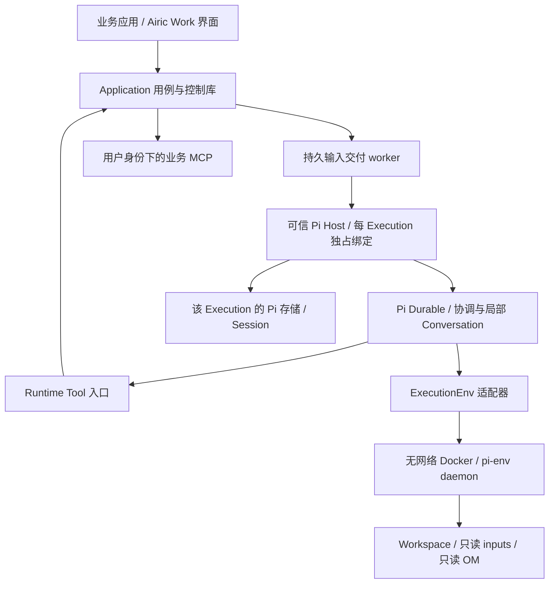

# Worker Skill 与 Pi Durable Agent 工作环境

| 项 | 内容 |
| --- | --- |
| 日期 / 状态 | 2026-10-30；Skill v0.2.0 与目标设计；Pi 固定源码机制实验已通过，完整 Runtime/业务环境集成未交付 |
| 产品依据 | [PRD](prd.md) 的 Ontology 与 Skill 体系；不新增产品实体或业务状态 |
| 行为入口 | [airic-work-worker](../backend/skills/airic-work-worker/SKILL.md) |
| 架构依据 | [技术设计](technical-design.md)；本文细化其 Pi、Workspace 与装配合同 |
| 当前实现 | PiRuntime、PiHistory、ApplicationWorkerHost、McpWorkerTools 和 ExecutionRunner 已实现，见 [模块说明](../backend/src/adapters/driven/runtime/README.md)；业务 MCP 凭据/HTTP 网关已通过真实 HTTPS 测试，见[接入说明](../backend/src/adapters/driven/mcp/README.md)；Docker Workspace 和附件物化仍待接入 |
| 分支执行细化 | [DecisionRequest 驱动的局部续行与分支调度](decision-continuation-design.md)；替代早期“单 Conversation”限制，内部策略为待评审提案 |
| Pi 实际依据 | [能力核实与具体接入](pi-durable-capability-review.md)；commit 固定、API 映射、原生 Task/ownership、258 项上游测试及 6 项实验 |

## 1. 从 Skill 推导环境

Worker Skill 是后台 Agent 的常驻执行方法，OM 是当前领域的方法。环境负责让 Skill 所依赖的行为成为真实能力，而不是继续往提示词里添加可靠性承诺。

| Skill 所需工作方式 | 环境必须提供什么 | 责任与当前落点 |
| --- | --- | --- |
| 接手委托、按固定 OM 工作 | 可信 Execution 快照；实际加载 Worker 与 Root；固定版本的按需读取 | ExecutionUseCases、Methods；装配适配器待实现 |
| 在用户身份下执行业务动作 | 动态发现与校验工具；凭据留宿主；运行代次栅栏 | McpUseCases、Mcp；真实网关待实现 |
| 提出问题后继续或让出执行 | 原子保存 DecisionRequest，立即返回 ID；用户回答另行投递 | DecisionUseCases 已有用例；工具入口与 Store 待实现 |
| 理解回答、更正和一般消息 | 持久有序输入；完整关联、Context 修订与附件路径 | InputUseCases；结构化信封映射待补齐 |
| 检查文件、写工作笔记 | 持续 Workspace；只读输入与 OM；隔离文件/Bash | Workspace、Files；Docker/pi-env 待验证 |
| 恢复时知道哪些发生过 | 原 Session 补读、稳定调用定位、覆盖限制、业务原操作查询 | QueryUseCases、History、业务 MCP 合同 |
| 有限让出、停止、结束后继续 | 宿主调度；同一 Session 重开；旧代次不能继续派发 | ExecutionUseCases、Runtime、Workspace |
| 交代结果可被用户检查 | 消息、工具参数及返回持久记录；脱敏；可重建操作索引 | History 与 QueryUseCases；不新建业务结果库 |

Skill 放在 `backend/skills/`，作为产品运行时资产随构建发布。`.agents/skills/` 供开发与 OM 设计使用，不扫描或自动装配给后台 Agent。当前 Skill 没有依赖别的作者 Skill 或本设计文档，宿主只装配 Skill 正文及明确的运行合同。

## 2. 首版运行拓扑

* 可信宿主运行模型客户端、Pi 调度、平台工具、MCP 客户端、凭据管理和 Session 存储；一个 Execution 一个 Pi 存储，其中可以包含协调与局部 Conversation。Session 统一保存各分支来源和进展，不能等同于一条线性模型上下文。Pi 内部 Task、Run、Submission 不映射成新的产品对象。
* 容器只执行文件操作和命令。模型与 MCP 不在容器中；容器不持有用户 token、模型 key、控制库、Pi 库或 Docker socket。
* 同一个 Execution 只允许一个持有存储与 Workspace 的活动宿主绑定。进程重启先取得独占锁并确认旧容器停止，再打开原存储；不靠“通常只有一个进程”代替约束。
* 分支由受控续行能力管理，不开放任意 fork/subagent、host eval 或绕过统一 MCP 入口的扩展。宿主负责全部 Conversation 的枚举、停止、回收与续行；不形成用户可分配的产品任务树，也不留下无人管理的后台工作。

## 3. 常驻指令与启动合同

### 3.1 装配顺序

每次模型请求使用同一组固定版区段：平台边界、Worker Skill 正文、Root OM、当前可信运行快照。其余 OM 文件按需读取。Root 和 Skill 都不能只作为磁盘链接出现；装配失败时不启动模型工作与外部调用。

平台边界限定身份、权限、工具及运行规则；Skill 规定通用工作方式；OM 规定领域判断和适用的强制过程；`task` / `instruction` 描述具体委托。它们不是可以相互覆盖权限的四级授权。领域规则与委托发生实质冲突时保留冲突并澄清，不静默放宽要求。业务工具返回和上传文件作为资料进入上下文，不注册为系统指令。

宿主记录实际装配的路径、SHA/摘要、Skill 版本、Runtime 包锁定信息、模型配置及镜像 digest。首次绑定时形成固定装配记录，后续续行比对；记录缺失或版本不可取得时阻塞并显示原因，不能换最新版继续。源文件改了但执行未重建时不能只按版本字符串判定一致，须核对内容摘要。

模型上下文压缩可改变当前可见历史，但不得丢失这些常驻区段。恢复摘要只辅助定位，原 Session 仍可补读；不要求把全部工具历史重新灌进上下文。

### 3.2 可信运行快照

以下是环境合同字段组，不是新增领域实体，也不是当前已发布的 DTO：

| 字段组 | 内容与语义 |
| --- | --- |
| `execution` | executionId、sessionId、generation；原 task/instruction；归属由宿主绑定，不给模型身份覆盖参数 |
| `method` | source、commitSha、rootPath、内容摘要；只读快照 `/om` |
| `worker` / `runtime` | Skill 版本与摘要；锁定依赖、环境镜像及模型标识 |
| `paths` | `/workspace/work`、`/workspace/inputs`、`/om`；仅容器内路径，无宿主秘密路径 |
| `capabilities` | 实际注册的工具名、Schema、边界与必要的结果语义；缺能力必须明确，不能只写预期清单 |
| `continuation` | 本次是首次输入、普通续行或中断恢复；原停止边界、未决请求和相关未知调用的定位；大结果分页 |

快照由应用和绑定记录构建，不把模型回传的快照当作授权依据。动态资格和代次仍在用例提交及网络派发前重新检查。

## 4. 输入、人工协作与运行收尾

### 4.1 输入信封

业务字段保留结构，不把所有输入压成一段无来源字符串。Pi 的可读消息是信封的呈现；Session 中保留 inputId、原对象关联及 Schema 版本，必要时可补读完整结构。

| 公共字段 | 专用内容 |
| --- | --- |
| `inputId`、executionId、持久 sequence、kind、提交时间、来源归属 | `start`：原 task 与 instruction |
| 同上 | `user-decision`：userDecisionId、完整 DecisionRequest 标识、Context 修订、选项 ID 与显示文本、用户原文、correctionOf、附件 |
| 同上 | `steering`：一般消息原文、附件；不填造 DecisionRequest 关联 |

附件描述含 uploadId、原文件名、固定内容标识/哈希/大小和容器内已就绪路径。文件名只用于展示，不作为路径或内容身份。输入与 DecisionRequest 的业务标识使用完整术语；Pi 的 `requestId` 参数只是投递去重键，不是 DecisionRequest 的标识。

当前 `Input` 只有 sourceId/kind/text/files 等最小字段。适配器可以在投递前按 sourceId 从权威控制记录组装完整信封；需固定同一 inputId 的信封版本与摘要，使查回和重试内容相同。不能只把 `optionId` 当作用户原话，也不能读取“最新 Context”代替用户实际阅读修订。该映射需新增应用查询/快照合同并验证，不能让 Pi 适配器自行解释专业判断。

### 4.2 持久交付与忙时输入

沿用技术设计的应用 Outbox 与 `InputUseCases.dispatchInput`：物化文件 → 确认原环境 → 启动当前代次 → 查原 inputId 的接收状态 → 必要时投递 → 本地确认。Session receipt 将原 inputId 固定映射到目标 Conversation 和原生 run-slice Task；Pi submission 使用该片段稳定 requestId，不能重试时重建 Task 或切换 Conversation。内部自动继续有独立稳定身份，不伪装成新的用户输入。

首版通过原生 run-slice Task 的活动槽控制片段准入；目标本应空闲时用 `whenBusy: reject` 检出重复运行。输入按局部流有序安排，而不是把所有工作提前塞进 root 的 follow-up 队列。平台术语 Steering Input 不自动映射为 Pi 的 steer；不默认中断在途业务动作来插话。需要使用原生 followUp 的内部通知也保留稳定身份与来源。

上述队列约束应用于明确路由后的局部输入流，不能把所有回答追加到 root。Session 级先固定 inputId 的目标续行与分支绑定，再提交到固定 Conversation；原生 requestId 的分支内去重不代替全局接收去重。附件失败与无关输入的隔离、Steering 的控制边界及调度公平性见局部续行提案；当前全局顺序前置检查需要评审后调整。

已接收只证明 Runtime 持久接收。Agent 是否看见、是否完成该轮处理用 Session / submission 事实说明，不增加专业采纳流程。

### 4.3 DecisionRequest 工具

创建工具调用 `DecisionUseCases.createDecisionRequest`，宿主注入身份、Execution、generation 和稳定命令键。Schema 接收问题、选项和 Decision Context；来源引用只用于该 Context 的理解与定位。工具返回持久 request 标识及保存状态，不等待人。当前首版界面每个请求独立展示，选项无默认勾选，并允许文字与文件。

相同工具调用重放查回同一 DecisionRequest。补充 Context 走 `refreshContext` 并检查修订。UserDecision 由界面提交并原子记录“已回答 + 待投递输入”，Worker 不通过工具替用户回答。部分回应只处理其覆盖范围；未覆盖问题如仍需回应，另发 DecisionRequest，不重新打开已回答请求。

提出请求时同时固定局部工作范围和来源位置；安全上下文锚点在该工具轮真实终结后固化。请求保存、锚点就绪、用户回答和分支调度是不同事实；回答先到不影响 answered。一个局部工作可依赖多条请求，其回答累计进入同一续行，不反复 fork 相同工作。锚点、交接和恢复细节以配套提案为准。

不建立第二个 Decision Episode 存储；查询组合请求生命周期、UserDecision 与显式关联 Session 记录。

### 4.4 让出执行、结束与取消

Worker 在完成当前可做部分或需要等待时结束当轮回复，说明工作进展与阻碍。首版不要求模型调用“业务已完成”工具，也不解析自然语言回复来判定业务完成。

Pi Host 观察到所有分支无 ready/running 工作、没有已接收的就绪输入且工具退出后，才由宿主显式调用 `finishExecution`。不能以 root 空闲或应用输入 delivered 判断整个 Execution 已无工作。Store 的版本/代次/输入检查还须与 Session 整体活动事实协调，具体合同见提案。竞争到达的新消息使收尾失效，继续处理原队列。结束可以仍有待回答请求；不增加 `waiting` 产品状态。正常让出、局部失败和宿主故障分别记录真实原因，不能把 Pi 错误当成正常完成。

取消：先持久化 Execution 级停止栅栏 → 对 background anchor ownership 树调用 `root.abort(context, { background: true })` 并停止容器进程 → 查明各分支队列撤回与工具退出 → `confirmStopped`。普通 root.abort 不覆盖后台边界。已接收但被撤回的 submission 保留原事实，不误报为已处理；新输入不自动重投已取消动作。SDK 取消接纳之后新建工作仍须由全局栅栏禁止。

新输入到达 ended / failed / stopped 后，仍由既有用例确认旧运行已退出并递增 generation，再恢复原 Session 与 Workspace。宿主必须阻止 Pi 在旧代次自行恢复工具派发；取得新代次后才允许调度。停止不是业务回滚，在途 MCP 的结果需按原调用核验。

未取消的进程崩溃恢复沿用原 generation。取消后的新代次先完成旧任务终止与未知效果核验，再处理新输入；不能把旧工具上下文中的 generation 改成新值，以此让已取消动作继续执行。

## 5. 实际能力表与工具入口

下面的名字是首版拟定的模型工具名，尚未实现。宿主装配时须公布真实 Schema；Pi API 名与这些产品工具名分开管理。

| 模型能力 / 拟定工具名 | 允许输入与返回 | 负责的用例或机制 |
| --- | --- | --- |
| `work_get_context` | 原委托、版本、请求状态、停止边界；分页而非整库 | 需补齐受当前 Execution 约束的运行快照查询 |
| `work_read_session` | 当前 Session 游标与范围；含覆盖限制 | QueryUseCases → History；不开放任意用户 Session |
| `work_request_decision` | question、options、context → 完整 DecisionRequest ID | DecisionUseCases；命令键由 Runtime 调用身份注入 |
| `work_refresh_decision_context` | 当前执行请求 ID、下一修订内容 | DecisionUseCases；不覆盖旧阅读修订 |
| 局部续行与 `work_yield`（提案） | 工作范围、依赖、恢复指示、结构化让出结果；不接受任意 Session/fork 身份 | 新应用合同待评审，宿主落实提问锚点、路由和调度 |
| `work_discover_tools` | 已配置连接、查询 → 动态工具 Schema 与分类来源 | McpUseCases；模型不能添加连接或凭据 |
| 发现后的业务工具 | 按具体 MCP Schema 入参；返回 callId、确认状态与脱敏结果 | 所有调用统一走 McpUseCases，不直连客户端 |
| `read` / `list` / `search` | 仅容器可见目录，明确截断与读取错误 | ExecutionEnv；OM、inputs 只读 |
| `write` / `edit` / `bash` | 仅受限容器；工作文件持久化 | ExecutionEnv；不能调用宿主 Bash 或联网 |

动态发现可以是常驻 discover + deferred tools；首版无需额外 Code Mode。模型未启用的工具也不能通过嵌套工具入口绕过限制。默认只开放当前 Execution，身份、generation、inputId 与 callId 来自可信调度上下文；允许传入的 DecisionRequest ID 也须校验归属。

当前 Mcp.tools 只返回名称、Schema 修订与分类元数据，不足以生成可执行模型工具；需在端口合同中补充受控参数/结果 Schema、描述及版本变更处理。Schema 变化后不能用新定义解释旧调用；未注册、不可验证或已撤销工具拒绝执行，不按名字猜参。

不另加进度数据库、成果实体或通用业务上传工具。普通进度以 Agent 消息留在 Session；业务文件传输根据业务 MCP 的实际能力适配可信宿主，不能让无网络容器接管凭据或任意 HTTP。

## 6. 持久化、重放与未知效果

Session 保存消息、装配事实、输入关联、调用发起及返回。查询索引只派生读取，不成为第二条历史。SDK 存储与应用控制库分离；两边提交无法原子完成的窗口使用原 inputId/callId 查回。

| 动作 | 重放要求 |
| --- | --- |
| 接收输入 | 同一 inputId 查回原持久接收，不重复追加；未知不当作未接收 |
| 创建 DecisionRequest | 同一 Runtime 调用身份映射同一命令键，返回原请求 |
| 发起业务 MCP | 先在 Session 保存脱敏发起记录，再派发；同 callId 先读原记录，已有 calling 视为未知，不再发送 |
| 新的明确重试 | 新 toolCallId，保留可证明的 retryOf；业务幂等身份仍遵循服务合同 |
| 文件/Bash | 中断后核对实际文件与进程结果；不能仅因容器内操作就标记 replay safe |

具体保证由工具 wrapper 和宿主兑现，不交给模型生成稳定调用 ID。Pi 注册中的自动重放策略逐工具审查：业务 wrapper 只有在同一调用身份的恢复不重复发送已获证实后才可声明安全；普通 Bash 不声明通用安全。读取操作也需考虑文件变化，不能承诺重放总得到同一事实。

外部写入成功而 Session 返回未保存时，显示未知；按原业务身份查询回执。没有查询或幂等能力就停在可解释阻碍，不能由平台“通用 exactly-once”补齐。平台不为业务操作另建 Command/Outbox。

参数、结果与错误在进入 Pi 工具返回、Session 或模型前完成脱敏。不能只脱敏自建调用记录，却让 Pi 默认工具记录保存原始秘密。凭据由宿主另行注入，不进入输入、工具 Schema 或模型参数；需要秘密入参的业务工具改为宿主侧受控映射，不能直接暴露。

工具 execute wrapper 不能独自保证这一点：Pi 可能先持久保存模型产生的调用参数，再执行 wrapper。接入时必须查证模型响应、原生工具记录和错误的写入路径；输入与结果在进入 SDK 前脱敏，模型输出还需在首次持久提交前覆盖已知秘密检测/脱敏。找不到合适拦截点时明确阻塞该保证，不能声称执行后脱敏就已满足 Session 合同。该项须用包含测试秘密的故障场景检查原 Pi 存储，而非只检查前台视图。

## 7. 容器工作环境

| 项 | 首版设计 |
| --- | --- |
| 镜像 | 固定 digest 的最小 Linux 工具镜像，非 root UID/GID；发布时锁定基础镜像、pi-env daemon 与工具版本 |
| 默认工具 | sh/bash、基础文件工具、rg、Python 3；按具体 OM 需要增补已锁定依赖，不在运行中联网安装 |
| 挂载 | `/workspace/work` 可写；`/workspace/inputs`、`/om` 只读；单独受限临时目录 |
| 隔离 | 无网络、只读根、丢弃 capabilities、no-new-privileges、默认 seccomp；不挂宿主库、socket、秘密或其他执行目录 |
| 资源 | 部署配置 CPU、内存、PID、磁盘配额、单命令时限与输出上限；错误返回明确限制，不静默截断成完整结果 |
| 生命周期 | 按需起容器；空闲且进程退出后回收，Workspace 与固定输入不随回收删除；恢复时核验原挂载内容 |
| 可恢复范围 | 持久文件可恢复，进程内状态、临时文件和后台服务不承诺；不让长期进程成为未记录依赖 |

优先验证 `RemoteExecutionEnv` 经宿主 `Connection` 使用 `docker exec -i <container> <pi-env-daemon>` 的标准输入输出通道，禁用 TTY，确保协议与诊断输出分离。容器内 daemon 仅提供文件/命令能力；Docker API 由宿主调用，不交给模型。它是拟议接入，不是已证实的 Docker 驱动。若兼容性不成立，换受控 ExecutionEnv 适配器并跑同一合同；不回退到宿主任意文件或命令执行。

镜像缺依赖时报告所缺能力，由维护者构建新版供新 Execution 使用；已有执行的版本迁移需要显式策略和验证。方法要求的外部工作必须有业务能力合同，不能仅通过预装工具暗中扩大网络权限。

## 8. Pi 版本与验证依据

实际核实基线为上游 **v1.4.0 / 4a080252f06caf63a525d7873c5d94d3c23887e0**。临时官方 checkout 已通过选定的 258 项上游测试及 6 项场景实验，包含真实 Pi Harness 与 SQLite reopen；见[证据和复现步骤](pi-durable-capability-review.md)。项目仍未安装生产 Pi 包或形成生产锁文件；真实模型、业务 MCP、Docker 和 kill -9 未验证。

上游 [Durable README（v1.4.0）](https://raw.githubusercontent.com/earendil-works/pi/v1.4.0/packages/durable/README.md) 标为 experimental，并描述持久提交、重开、区段式提示词、忙时队列与取消接口。这些为适配提供候选机制；平台的身份、输入顺序、停止确认及业务效果仍由本设计的合同约束。

[Durable spec（同一 tag）](https://raw.githubusercontent.com/earendil-works/pi/v1.4.0/packages/durable/docs/spec.md) 区分 Session、Conversation、Submission，提供 requestId、游标历史与运行状态等接口定义。首次适配需证明 `Runtime.accepted` 的持久查回、单写者存储、队列撤回、可扩展历史和取消覆盖范围；不得把文档中存在类型当成产品保证已兑现。

[pi-env README（同一 tag）](https://raw.githubusercontent.com/earendil-works/pi/v1.4.0/packages/env/README.md) 给出 daemon 与 Connection 的远程文件/命令模型及 SSH 示例。Docker 标准流接入、资源隔离和容器停止确认属于 Airic Work 待验证内容，不将其视为上游现成部署方案。

具体实现采用 `AiricWorkExtension` 注册 sections、受控工具、后台 lifetime anchor 和 run-slice/report tasks；执行与 checkpoint 交给 Pi。正常工具轮经统一 wrapper 的 `control.terminate` 形成边界，run-slice.finalize 再固化锚点、释放槽并安排后续原生 Task。不用 fail-open 的 afterTools observer 保证可靠提交，也不另建通用任务执行器。异常工具轮的终止限制和模型/工具预算见能力核实第 5—6 节。

## 9. 实现分工与当前合同缺口

沿用 class 风格，候选适配器为 `PiRuntime`（Runtime）、`PiHistory`（History）、`DockerWorkspace`（Workspace）、`RuntimeToolController`（入口）。职责名称用于定位，具体拆分随适配复杂度决定。bindings 选择端口实现，Awilix 仅在组合根装配服务；适配器不把容器传入用例，也不绕过用例写控制状态。

进入 HOW 实现前，先补齐下列 WHAT 合同并完成内层/合同验证：

| 缺口 | 所属层与需要明确的行为 |
| --- | --- |
| 实际装配记录 | Application 的绑定/准备合同：固定 Skill/Runtime/镜像及内容摘要；当前 Method 中的版本字段不证明真实装配 |
| 运行快照与输入映射 | Application 查询合同：按归属和 inputId 组装关联、历史修订、选项原文与附件；适配器负责协议编码 |
| 动态 MCP Schema | Application 的 Mcp 端口：完整、可版本定位的工具定义；入口负责 Schema 校验和模型工具映射 |
| 调用身份与历史扩展 | Runtime/History 合同：SDK 调用 ID 到平台 callId 的稳定映射，DecisionRequest/输入关联、派发前发起记录与分页补读 |
| 原生记录脱敏 | Runtime 适配合同：模型调用参数、默认工具记录和错误首次持久化前的处理；不能只处理 History.appendCall |
| 取消与恢复观察 | Runtime 合同：区分已接收、已处理、被撤回；失败/空闲/已停止可查证，原 Session 续行不隐式重投旧动作 |
| 局部续行与整体活动 | DecisionOrigin、Continuation、Session 级路由和安全锚点；全分支空闲/取消、局部输入顺序与让出合同，见[详细提案](decision-continuation-design.md) |

不在本轮编造生产端口实现或改写第一阶段测试证据。上述缺口不表示已有 Domain 概念需要扩张；它们是让当前用例通过真实环境兑现所需的接口细化。

## 10. 验收场景与交付门槛

以下完整环境场景仍待执行。已有 Pi 机制实验只覆盖其中一部分；Skill 的真实 Agent 行为、Docker 隔离和独立业务验证分别提供证据，不能相互替代。

| 场景 | 可观察的通过依据 | 验证层 |
| --- | --- | --- |
| W01 固定装配 | Worker 与 Root 实际进入请求；按需读同 SHA；修改源文件不影响原执行；缺文件拒绝启动 | 装配 + Pi 合同 |
| W02 普通授权工作 | Agent 按 OM 完成可做工作，无逐次无意义确认；MCP 业务结果可查 | Agent + 隔离业务 MCP |
| W03 人工判断 | 一个明确问题生成一个持久请求；工具立即返回；无默认选项；用户回应后请求已回答 | Agent + Application + 界面 |
| W04 部分回答/更正 | 仅推进覆盖范围，保留来源与旧修订；另一个问题新建请求，无采纳门禁 | Agent + 输入信封合同 |
| W05 一般消息与附件 | Steering 不自动回答；同名文件不覆盖；未就绪文件阻止投递，提交事实保留 | Application + Workspace |
| W06 接收窗口崩溃 | Pi 接收前/后杀进程，原 inputId 查回；无双投或假 delivered，顺序一致 | Pi + Store 故障注入 |
| W07 写入窗口崩溃 | 业务已写而本地返回未保存；同调用重放不再次写；用原业务身份核验或停在未知 | History + MCP 故障注入 |
| W08 忙时与结束竞争 | 连续消息按序处理；新输入使收尾 CAS 失效；不能因一次回复丢掉后续输入 | Pi + Store 并发 |
| W09 取消与续行 | 在途 Bash/MCP、已接收排队输入均可观察；旧代次不派发；退出后新输入续行原执行，撤回动作不偷跑 | Pi + Docker + MCP |
| W10 环境隔离 | 路径穿越、符号链接、宿主命令、联网、越权目录访问失败；重启后 Workspace 文件仍在 | Docker/ExecutionEnv |
| W11 历史与脱敏 | UI 可展开真实调用参数；秘密未进入 Pi/Session/模型；重建索引后结果一致，缺口明确 | History + MCP 操作视图 |
| W12 上下文压缩与版本缺失 | 压缩后 Skill/Root 保留、原历史可补读；旧环境无法恢复时阻塞，不换版重建 | Pi 合同 + Agent |

下一步先完成第 9 节合同细化，并对候选 Pi 版本做 W01、W06—W10、W12 的最小集成验证。机制成立后实现生产适配器，再让真实 Agent 用隔离 MCP 跑 W02—W05、W11；只有走完委托、判断、补充、核查操作、结束后继续的闭环，才将本设计标为已验证。

分支与多请求还须覆盖[局部续行提案的 C01—C13](decision-continuation-design.md#12-需要证明的场景)。早期单 Conversation 场景不再足以证明完整执行模型。
