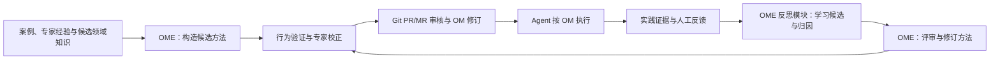
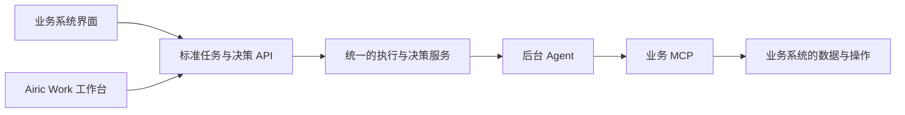

# Airic Work 产品定义

版本：Airic Work 新产品基线  
状态：目标产品定义；本文不代表相关能力均已实现。

本文中的“已确定”指本轮产品讨论已确定的定位、职责和设计原则，不代表已完成实现或验证。“待研究”指尚未形成产品决定的问题，不能直接作为实现契约。现有代码、功能完成度和迁移范围需要另行审计。

本定义采用新产品名称 Airic Work，项目与仓库名为 `airic-work`。OME Skill 覆盖 OM 的构造、评审、验证和实践改进，其中 Reflective Learning 作为按需加载、可单独调用的内部模块，支持在 Airic Work 后台和外部 Agent 中使用；Airic Work Skill 承载执行 OM 的标准方法。任务创建的主路径已确定为业务系统通过标准 API 发起 Agent 执行；业务系统和 Airic Work 工作台共用任务与决策服务。对外 MCP 暂不纳入产品范围；任务粒度、完整生命周期和具体 API 契约仍需详细设计。

## 1. 产品定位

**Airic Work 是一个以 Operating Model（OM）驱动自主执行、以 Decision Request 组织人机协作、以 Trajectory 支持持续学习的通用 Agent 平台。**

Airic Work 让组织把专业工作方法沉淀为可复用的 OM，并让后台 Agent 按照 OM 自主完成工作。只有在缺少必要 Context、遇到未解决的专业判断、需要授权或发现异常时，Agent 才请求人类介入。

业务工作主要在业务系统中产生。业务系统通过 Airic Work 的标准任务 API 创建、查询或取消 Agent 执行，也可以通过决策 API 查看 Decision Request 并提交处理结果。Airic Work 自带工作台为同一套服务提供通用界面，业务系统可以在自己的界面承载这些交互，或按需跳转工作台查看细节。

OME（Operating Model Engineering）提供构造和持续改进这些工作方法的工程方法。它帮助专家与 Agent 从具体案例、专业经验和可核验的领域知识出发，形成候选 OM，检验其能否指导实际工作，再根据实践修订。OME 同时参与初版形成与后续改进，是连接专家经验、自主执行和组织知识演化的关键环节。

Airic Work 的核心价值是连接开放的 OM、后台执行、异步人工决策和执行证据。通用交互式 Agent、代码托管和业务应用分别由成熟产品及业务系统提供。

本产品借鉴 Attention Cycle 中前台与后台工作分离、集中处理待决事项的思想，但不将当前产品定义等同于完整的 Attention Cycle 实现。外部 OME Agent 与后台执行 Agent 是职责独立的工作环境：前者与专家共同创建和完善 OM，后者按照 OM 执行工作。两者不构成持续的任务委派或上下级 Agent 关系。

已确定后台自主执行、业务系统通过标准 API 发起执行以及内外共用任务与决策服务的产品方向。后台执行如何划分、完整生命周期如何组织，以及接口的具体契约，仍是第 14 节所列的开放问题。

### 名称与项目组织

| 项目 | 名称与定位 |
| --- | --- |
| 产品名称 | Airic Work |
| 新项目目录与仓库名称 | `airic-work` |
| 产品描述 | 由 Operating Model 驱动的自主工作平台 |
| OM 工程方法 | OME Skill，包含 Reflective Learning 模块 |
| OM 执行方法 | Airic Work Skill，供后台与外部 Agent 使用 |

### 与旧 AiricForge 的关系

Airic Work 在新目录与新的 GitHub 仓库中建立实现主线，以本文确定的产品职责与边界组织设计。旧 `airic-forge` 保留为历史实现与参考仓库，计划在保存现有工作和需要保留的资产后归档；本文不表示新仓库已创建或旧仓库已完成归档。

新项目按实际需要引入旧项目中适用的独立组件、方法、案例和工程经验。旧版的 Work/Turn、App 集成和自建 OM 治理机制不自动成为新项目的产品契约。已有 OM、运行数据和历史轨迹分别保留，是否迁入新项目及迁移范围按实际需求确定。

## 2. 核心设计原则

### 2.1 Decision-centric OM

OM 的核心知识单元是可复用的 Decision。标准、确定性的步骤优先由业务系统或确定性程序执行；OM 的重点是专业 Judgment 的复用。

Decision 可以包含：

- `Question`：需要解决的判断问题。
- `Trigger` / `Applicability`：何时需要考虑该 Decision，以及什么情况下适用。
- `Context Dependencies`：判断所需的事实、规则、状态和其他知识。
- `Judgment`：判断逻辑、权衡原则或方案选择方法。
- `Outcomes`：可能结论及其后续含义。
- `Precedents`：支持理解和复用判断逻辑的案例。
- `Knowledge Gaps`：尚缺少的规则、知识或适用边界。
- `Validation`：判断方法及其结果的验证方式。
- 可选的 `Objective`、`Constraints`、`Authority`、`Feedback` 等 Section。

Root OM 负责定义工作范围、组织知识、提供 Decision Routing，并声明必要的领域 MCP 依赖。具体 Judgment 下沉到 Decision Artifact。Decision 的适用条件描述专业判断何时适用；业务系统通过任务 API 发起执行时，仍需明确执行目标与范围。两者分别承担判断适用性与执行发起的职责。

Precedent 在概念上属于对应 Decision 的知识内容。软件项目的 ADR 既可以作为其他 Decision 的 Precedent，也可以是当前项目仍然有效的架构约束。

### 2.2 Git-native OM

OM 是开放 Git Repository 中的知识资产。GitHub、GitLab 等平台负责文件持久化、版本历史、Branch/Commit、PR/MR、Review、审批、合并和仓库权限。

Airic Work 可以解析和索引 OM，展示 Decision 关系与 Knowledge Gap，并关联具体修订及 PR/MR。OM 的版本控制与变更审核继续使用 Git 平台提供的机制。

执行时使用的 OM 必须对应明确、可追溯的 Commit SHA。仓库后续修改不能静默改变既有执行所依据的知识版本，也不能改写历史记录。版本如何绑定到未来的后台工作单元、何时允许切换版本，随任务模型另行研究。

### 2.3 Open Agent Ecosystem

用户可选择 Codex、Claude Code 等成熟交互式 Agent。OME Skill 提供 OM 构造、评审与持续改进的方法，其中 Reflective Learning 模块承接实践学习；Airic Work Skill 提供 OM 执行的方法。两个 Skill 及 OME 内的反思模块可在具备相应能力与权限的 Agent 环境中使用。

外部 Agent 直接操作 OM 文件目录，通过 Git 仓库与 Airic Work 同步知识修订；执行领域工作时使用有权访问的业务 MCP。任务与决策信息由标准 API 在授权范围内提供；分析所需的完整实践证据，以实际可取得且经授权的记录为依据，具体读取范围与交付方式另行设计。使用哪一种方法，取决于正在进行的活动；使用外部 Agent 不意味着只承担 OME。

领域能力由业务应用通过 MCP 提供。与业务项目的集成重点是可靠的 API/MCP、OM，以及身份、权限和连接配置；Airic Work 不为每个业务 App 开发深度定制的 Agent 集成。

### 2.4 Asynchronous Execution

后台 Agent 独立运行，不要求工程师持续盯着对话窗口。在依赖与授权允许的情况下，局部待决问题只阻塞受影响的工作，Agent 应继续处理不依赖该问题的部分。

Airic Work UI 提供可选的执行对话和进度查看，用于观察、询问和受控交互。业务系统也可通过标准 API 展示进度和处理待决事项。用户不需要保持任何一个窗口打开，后台工作也不依赖同步聊天持续存在。

这是自主执行与人机协作的行为原则；具体工作单元、并发方式、等待与恢复机制尚未确定。

### 2.5 Evidence-grounded Learning

实践可以产生新的知识，Trajectory 保留了发现这些知识的证据。Reflective Learning 从执行中的摩擦、人工纠正、意外成功和其他有信息量的片段中提出可复用经验，并保留其适用条件与不确定性。

Trajectory 本身不自动构成正确知识。学习结论需要区分观察事实、原因解释和改进候选，并通过归因确定应由哪一部分知识、执行方法或工具能力承接。

解决当前问题、提取实践经验和正式修订 OM 是相互关联但职责可区分的活动。OME 的持续改进过程通过内部 Reflective Learning 模块从实践中发现问题、形成解释与学习候选，再完成方法修订和行为验证。合并后仍保留学习候选、候选修订与正式采用的区别；涉及 OM 的变更通过专家协作、必要验证与 Git PR/MR 审核后进入权威 OM。

### 2.6 内外共用的任务与决策服务

Airic Work 面向业务系统提供标准任务与决策 API，并将其作为正式产品契约维护。业务系统界面与 Airic Work 工作台通过同一套契约使用执行和决策能力，共用状态、权限与处理规则。

任务创建、查询、取消以及 Decision Request 的查询和处理，归属统一的应用服务。Runtime 内部的调度、检查点及状态推进由内部机制承接。公开 API 表达用户可理解的产品操作，不要求把运行时内部操作直接暴露给调用方。

业务任务由业务系统管理，Agent 执行由 Airic Work 管理，两者通过稳定引用关联。外部调用与内部工作台操作不能各自维护一套执行或决策状态。

## 3. 系统职责边界

### Airic Work

Airic Work 的已确定职责包括：

- 提供标准后台 Agent Runtime，使 Agent 能够按照 OM 自主执行。
- 提供标准任务 API，承接业务系统创建、查询和取消 Agent 执行。
- 保存执行过程、进度、结果和恢复所需记录，并建立可追溯的审计关联。
- 提供 Decision Request 和 Decision Brief，集中承接人工介入。
- 提供决策 API，使业务系统与自带工作台能查询待决事项、提交处理结果并查看后续情况。
- 提供执行对话、执行事件、Trajectory 与 Decision Episode 的查看和关联能力。
- 解析和索引 OM，展示 Decision 关系与 Knowledge Gap。
- 为 OME 的 Reflective Learning 模块提供后台运行环境和执行证据，关联学习发现及改进建议。

后台执行的主要创建路径是业务系统调用标准任务 API。执行粒度、完整生命周期、其他创建来源及 API 的具体数据结构由后续设计确定，本节不预先规定 Run/Task 的最终对象命名或完整状态机。

Airic Work 不拥有业务系统的权威业务状态；OM 的版本管理、审核与合并由 Git 平台负责。

### GitHub / GitLab

Git 仓库是 OM 内容与修订的 Source of Truth，GitHub、GitLab 等平台负责版本控制、变更评审、审批和合并。Airic Work 可关联仓库、Commit 和 PR/MR，并展示相关知识与执行证据。

### 外部交互式 Agent

用户通过 Codex、Claude Code 等成熟产品与专家协作。外部 Agent 可以使用 OME Skill 创建和改进 OM，按需调用其中的 Reflective Learning 模块分析实践经验，使用 Airic Work Skill 执行 OM。

外部 Deep Focus 是专家共创、复杂分析和深入调查的工作环境。它直接操作OM文件目录，通过Git仓库与Airic Work同步，与 Airic Work 后台执行保持职责独立，不要求共享同一段对话，也不承担持续指挥后台 Agent 的职责。

两个 Skill 与 OME 反思模块的具体分工见第 4 节。

### 业务应用

业务应用（例如 CertLab）拥有业务事实和操作的 Source of Truth，包括身份、权限、业务任务及其业务生命周期、业务对象、状态、文档、证据、业务规则、写入校验、原始回执和审计。

业务应用决定在什么业务情境下发起 Agent 执行，通过标准 API 将执行与业务任务关联，并按需要展示执行进度、结果及待决事项。业务上的完成或正式审批，仍依据业务系统自身的条件与权限确认。

业务应用通过 API/MCP 暴露领域能力。Airic Work 必须遵守业务权限与状态校验；业务 UI 继续服务于业务用户，不需要成为 Agent 的主要操作界面。

### 数据所有权

| 对象 | 权威所有者 | Airic Work 的职责 |
| --- | --- | --- |
| OM 文件与修订 | Git 仓库及其托管平台 | 解析、索引、关联、展示 |
| 业务事实、证据与业务状态 | 业务应用 | 通过 MCP/API 访问和引用 |
| 业务任务、业务目标与业务完成状态 | 业务应用 | 关联执行来源和范围，提供 Agent 执行情况与结果 |
| Agent 执行状态、进度和取消结果 | Airic Work | 通过统一任务服务维护，并向有权调用的业务系统与工作台提供 API |
| Airic Work 后台执行记录与 Trajectory | Airic Work | 持久化、恢复支持、审计、分析；具体工作对象模型待定 |
| Decision Request 与人工处理记录 | Airic Work | 创建、展示、接收决定，并关联受影响的执行 |
| OM 变更审核与合并 | GitHub / GitLab | 关联学习发现、改进建议与 PR/MR |
| 外部 Agent 的对话与本地工作区 | 用户选择的 Agent 环境 |  提供Airic Work相关的Skill |

## 4. 标准后台 Agent 与 Skill 体系

### 4.1 标准后台 Agent Runtime

Airic Work 提供标准后台 Agent，目标运行时选用 Pi Durable。

目标是提供稳定、足够通用的执行环境，复用成熟 Agent Runtime 的能力。标准通用能力范围包括文件读写、Shell/代码执行、文本与结构化数据处理、常见文档处理和 Context 检索；Airic Work 另外提供 Decision Request 及执行记录等平台能力。

具体能力以实际发布的 Runtime 能力说明和验证结果为准。某项能力在 Codex 本地可用，不能据此推定 Airic Work 后台同样可用。

领域特有能力通过 MCP 扩展，例如查询评估项目、检索证据、提交评估发现或更新业务状态。OM 声明必要的领域能力依赖，不绑定具体模型、Harness 内部工具名、MCP Endpoint 或凭据。

OME 应了解目标 Runtime 的标准通用能力，以及所需领域 MCP 的契约、权限和限制。通常只需检查标准能力是否足够、领域依赖是否可用，以及特殊能力是否存在缺口；无需在每个 Decision 中重复声明基础工具能力，或为每份 OM 建立独立的通用能力体系。

执行应满足以下约束：

- 实际使用的 OM Commit SHA、Runtime 及相关 Skill 版本可追溯。
- 具有明确的执行身份、业务范围、权限和限制。
- 业务写入通过业务应用受控接口完成。
- 外部副作用需考虑幂等性、失败重试和恢复。
- 执行恢复时重新判断业务授权是否仍然有效。
- 文件、Shell、网络和敏感数据访问具有明确边界。
- Runtime、模型或执行方法升级后，通过代表性 OM 和回归案例验证行为。

这些约束不预设后台任务的数据结构、状态或生命周期。实际采用的 Pi Durable 对象与机制需要经过后续设计和验证，不能直接等同于 Airic Work 的产品对象。

### 4.2 两个 Skill 与 OME 反思模块的分工

| Skill | 核心问题与职责 | 主要产出 | 使用环境 |
| --- | --- | --- | --- |
| OME Skill | 如何从案例与专业知识构造工作方法，评审其可执行性，并通过验证和实践持续修订？ | 包含工作范围、Decision、Context 依赖、协作方法、Precedent、Knowledge Gap 及验证依据的 OM，以 Git 仓库维护 | 外部交互式 Agent 与专家共创环境；其中的反思模块也供 Airic Work 后台使用 |
| Airic Work Skill | Agent 如何按照 OM 执行工作？ | 依据 OM 作出的判断、受控操作、执行结果、证据及必要的 Decision Request | Airic Work Pi Durable Agent；具备所需能力与权限的外部 Agent |
| OME 内的 Reflective Learning 模块 | 实践带来了什么可复用的新知识，应改进哪里？ | 有证据的 Knowledge Delta、归因、学习发现与改进候选 | Airic Work 后台；具备相关证据访问能力的外部 Agent |

产品以 OME Skill 和 Airic Work Skill 作为两个顶层方法入口。Reflective Learning 合并为 OME 内部模块，按需加载并支持单独调用。OM 工程、OM 执行与实践学习仍具有可区分的方法职责；一次工作可以涉及多类活动，但不要求它们共享同一 Agent 会话或同一执行生命周期。

### 4.3 OME Skill：构造、验证与持续改进工作方法

**OME Skill 指导专家与 Agent 将专业工作方法构造成可执行、可验证、可演进的 OM。它覆盖初版构造、已有方法评审和实践驱动的修订；初版 OM 是需要通过实践检验的方法假设。**

Reflective Learning 是 OME 持续改进流程中的内部模块，负责从实践证据提取经验、形成归因与改进候选。它与初版构造、评审和验证方法按需组合，具体方法与使用边界见第 4.5、4.6 节。

其工作对象是设计方法的人及候选 OM。成果以 Git 仓库中的 OM 文件与相关验证材料维护，复用已有组织方式。OME 需要说明工作如何推进、关键判断如何作出、缺口如何承接及结果如何使用，再规定成果的表达方式。

#### 4.3.1 从具体案例形成候选方法

OME 可以从专家与 Agent 共同完成一项代表性任务开始，在合作中追问关键分岔、依据与例外，提取可复用的 Decision。它也可以评审已有 OM，或在过程记录不足时提出待验证的过程假设，不要求专家事先提供一套完整 SOP。

不同材料承担不同作用：成果样例说明下游需要什么；执行轨迹说明实际发生了什么；专家解释提供判断理由与例外；模型已有领域知识可帮助提出候选方法和访谈问题；业务 App/MCP 合同约束实际可用能力。这些来源需要区分，模型提出的方法不能写成已发生的专家实践，成品样例也不能单独证明真实工作过程。

OME 从代表案例中形成最小的工作闭环，主要处理：

| 方法活动 | 应形成的具体内容 |
| --- | --- |
| 定义有效推进与完成 | 谁依据什么产物能够做什么；如何识别看似完成却无法使用的结果 |
| 重建过程与划分工作环节 | 从输入到产物的可行路径，以及按独立价值、责任交接和中断接续判断的工作边界 |
| 提炼关键 Decision | 对比相似案例中不同的行动，找出改变选择的事实、判据、适用条件与例外 |
| 设计缺口去向与协作恢复 | 缺少事实、专业判断或能力时由谁承接；交付什么；收到完整或部分结果后如何核验和继续 |
| 映射真实能力与组织知识 | Context 从哪里取得、动作由哪个业务能力承接、效果如何确认，以及知识从哪个入口被加载 |
| 编写并验证候选 OM | 用原案例、相邻反例及必要的受控执行检查方法是否支持具体选择与业务产物 |

这些是 OME 推导方法时的活动，可以随证据往返修订。写入 OM 的内容继续围绕 Decision 组织专业判断，以 Root OM 提供范围与路由，并保留执行所需的协作方法与引用。设计过程、验证说明和全部原始材料不需要默认装入每次执行上下文。

OME 可以研究领域工作的适当环节与交接边界；这不等于决定 Airic Work 后台任务的产品粒度、Task Contract 或生命周期。

#### 4.3.2 让方法与执行语义、能力和责任相匹配

OME 应参考 Airic Work Skill，了解执行方如何路由 Decision、取得 Context、处理 Knowledge Gap 和请求人工介入；并了解目标 Runtime 的实际能力及业务 MCP 的合同。关键方法要求都应有可执行、可观察的路径。

专业知识按适用领域、标准及版本定位，项目事实保留在业务记录，通用能力由 Runtime 或基础 Skill 承接。业务权限、状态校验和事务继续由业务系统负责，OM 不复制一套权限表、工具白名单或业务状态机。

发现缺能力、合同含糊或协作入口缺失时，OME 应说明具体场景、期望行为和责任归属，形成能力或产品改进需求。建议中的能力仍是依赖或缺口，不能按已可用能力编入执行方法。

#### 4.3.3 以行为验证支持修订与采用

OME 需要同时检查判断是否受证据支持，以及工作能否有效推进：能做的部分应形成可用产物，未决缺口应有承接方式，新的信息回来后应能继续。验证围绕正常推进、关键分岔、输入不足和交接恢复等与当前范围相关的场景展开。

验证记录应区分静态检查、情景推演、模拟工具执行和真实 Agent 受控运行。结构正确或一次试运行成功，只能支持相应范围的结论，不能据此宣称专业行为已稳定或已适用于整个领域。

实践暴露偏差后，OME 重建实际输入、可见上下文、版本、动作和业务结果，比较规则缺失、规则未加载、知识不足、能力问题和局部执行偏差等解释。它形成带有依据、适用范围、预期行为变化及验证办法的候选修订；证据不足时，也可以给出待验证假设或目前不修改 OM 的结论。

候选修订、审核合并与投入运行分别受相应权限和流程约束。采用后仍需观察收益与退化，出现新证据时可以收窄、撤回或扩大适用范围。

#### 4.3.4 OME 在整个闭环中的作用

OME 在闭环起点帮助组织形成可供执行的初版方法，在运行准备时检查知识、执行语义与实际能力是否匹配，在实践之后将有证据的发现转化为经过验证的修订，并用后续结果检验这些修订。它持续连接专家知识、候选方法、执行行为和知识版本。

对 OME 的评价应看候选 OM 是否让执行者作出具体选择、交付有用产物并接续工作，而不只看文档是否完整。现有 `operating-model-design` Skill 已提供可参考的方法版本；其与本产品 Skill 体系、后台环境和知识格式的具体适配仍需验证。

### 4.4 Airic Work Skill：执行 OM 的标准方法

**Airic Work Skill 是指导 Agent 加载、理解并执行 OM 的标准执行方法。它可以作为可复用 Skill 分发，也可以按运行环境装配为后台 Agent 的 system-prompt 式核心行为规范。**

其职责包括：

- 理解工作目标、范围、约束与授权，识别当前执行依据的 OM 修订。
- 根据 Root OM 进行 Decision Routing，识别适用的 Decision 与相关知识。
- 按 Context Dependencies 获取和核对事实、证据、规则及业务状态。
- 在适用边界内使用 Judgment 与 Precedent，区分已知事实、假设和不确定性。
- 通过可用的通用能力与领域 MCP 执行受控操作，并核对权威业务回执。
- 识别当前事实缺失、可复用知识缺口、能力不足、授权要求及异常。
- 在无法自主解决或必须由人作出决定时，准备 Decision Brief 并发起 Decision Request。
- 使用有效的人工处理结果继续相关工作，保留执行依据、人工干预和结果证据。

Airic Work Skill 供 Airic Work Pi Durable Agent 使用，也供外部 Agent 用于执行 OM。可移植性要求执行方法与具体工具适配分离：方法可以复用，工具、权限、持久化和人工介入通道仍由宿主环境提供。外部环境缺少必要能力时，应明确暴露缺口，不能假定其具备 Airic Work 的全部平台能力。

OME 创建和验证 OM 时，应参考 Airic Work Skill，了解 OM 将如何被加载、路由、取用 Context、执行 Judgment，以及何时请求人工介入。这使 OM 的设计与执行语义保持一致，而不要求 OME 了解 Runtime 内部实现。

Airic Work Skill 的核心职责是执行 OM。具体宿主工具与平台能力由相应环境提供和说明，Skill 不预设外部 Agent 可以调用 Airic Work 的管理接口。

### 4.5 OME 的 Reflective Learning 模块：可移植的实践学习方法

**Reflective Learning 作为 OME Skill 的内部模块，参考 Reflective Bootstrapping，将实践中的发现转化为有证据、有限定范围、可供人审阅的学习成果。该模块按需加载、可单独调用，并支持在不同 Agent 环境中使用。**

它既可在 Airic Work 后台执行，也可在外部 Agent 中执行。输入是可访问的 Trajectory、当时相关的 OM/Skill/指令及其版本，以及可选的历史反思案例。所需证据可能来自当前上下文、保存的执行记录或经授权检索的片段。

该方法包括：

1. **Observe**：重建原有预期，定位摩擦、人工纠正、意外成功或其他值得研究的片段。
2. **Reflect**：选择适当的观察视角，比较可能解释，提出带有适用条件与不确定性的 Knowledge Delta。
3. **Attribute**：核对可用证据与来源，判断问题涉及 OM 知识、Context Routing、执行方法、工具能力还是其他责任范围。
4. **Propose**：形成具体改进候选，说明目标、影响范围、预期行为变化及验证办法；必要时可以准备候选修改。
5. **Synchronize**：向人解释发生了什么、学到了什么、证据支持到哪里，并保留人的补充、纠正和判断理由。
6. **Revisit**：检查采纳、拒绝、修正及后续实践的结果，为改进知识和反思方法本身提供证据。

证据定位和来源核对应尽可能使用确定性工具；解释与行为归因需要保留替代解释。无法确认实际加载过哪些知识、来源版本不完整或轨迹因压缩而缺失时，应明确记录证据限制。

Reflective Learning 可以发现 OM 缺陷并准备修改候选。涉及 OM 的发现需要在 OME 改进过程中继续完成专业澄清、方法修订与行为验证，再由 Git PR/MR 流程承接审核和合并。反思模块与后续修订、验证方法可由不同会话或执行者承接，通过证据与版本关联。工具或 Runtime 缺陷则交给相应责任方，不能把所有发现都转成 OM 规则。

反思结果不自动更新权威 OM，也不自行改变权限、审计机制或人确定的约束。Reflective Learning 的运行入口、调用时机和调度方式，随相关产品设计另行确定。

### 4.6 合并后的组织与使用方式

**已确定：OME 作为 OM 构造与持续改进的主入口，Reflective Learning 作为其内部模块，不再单列为顶层 Skill。** 反思、归因、Knowledge Delta 和改进候选的共同方法在 OME 内维护，初版构造、评审和实践改进按需加载各自内容。

| 使用场景 | 方法使用范围 | 结果与后续 |
| --- | --- | --- |
| 与专家构造初版 OM | 加载 OME 的案例推导、方法构造和验证内容 | 形成候选 OM、验证依据与明确的未决问题 |
| 根据实践改进已有 OM | 加载 OME 的反思模块，并按需要继续修订与行为验证 | 形成有依据的学习候选或 OM 修改，经相应审核后采用 |
| Airic Work 后台或外部 Agent 仅开展反思 | 单独调用 OME 的反思模块，读取授权范围内的证据与相关知识 | 形成 Knowledge Delta、归因和改进候选，由有权执行后续工作的人或 Agent 承接 |

模块单独调用不要求加载完整的初版设计过程，也不要求共享原执行会话。方法仍可在 Airic Work 后台和外部 Agent 中复用；具体模块入口、分发、加载与宿主适配方式属于后续实现设计。

合并不改变权限与采纳边界。后台 Agent 运行反思模块时，其执行范围不因模块属于 OME 而扩大到权威 OM 的修改或发布。学习候选、候选修订、验证结果及正式采用分别保留相应依据和记录。

后续验证应覆盖初版构造、已有 OM 的实践改进和后台仅提取学习候选三类场景，检查是否只加载相关内容、是否产生可用结果、是否避免重复维护规则，以及是否区分候选、修订与采用权限。这里确定的是方法组织与产品边界，不代表模块已完成实现或验证。

## 5. 核心概念

本节确定概念含义和职责关系，不规定数据库 Schema、API 对象或状态机。后台执行对象的名称、粒度和关联结构仍待研究。

### 业务任务与 Agent 执行

**业务任务** 是业务系统中的工作义务，说明为什么开展工作、需要形成什么业务成果，以及何时达到业务完成条件。

**Agent 执行** 是 Airic Work 对授权工作范围的执行过程，关联业务来源、目标、范围和所用 OM，并记录执行进度、结果、轨迹及 Decision Request。

两者使用稳定的业务引用与执行标识建立关联，分别维护自身的状态。Agent 执行结束不能自动等同于业务任务完成。是否允许同一业务任务对应多次执行、如何重试或重新开展工作，以及不同执行如何共同覆盖业务义务，仍需详细设计。

### Decision Model 与 Decision Request

**Decision Model** 是 OM 中可复用的 Judgment Knowledge。  
**Decision Request** 是具体执行情境下产生的待处理事项，引用相关 Decision Model，并保留该情境的 Context、人工答复和处理结果。

Decision Request 不一定代表 OM 有缺陷，也可能只是缺少当前事实、需要业务授权或等待独立审核。当前资料不足与可复用知识不足需要分别识别。

### Decision Brief

Decision Brief 是面向人的结构化决策上下文。Agent 应尽可能在请求人工介入前准备好它，包括：

- 来源执行及关联的 Decision Model、OM 修订。
- 问题、触发原因和已知事实。
- 关键假设与缺失 Context。
- Evidence References、来源版本和定位信息。
- 候选方案、Agent 建议及理由。
- 不确定性、风险和预期影响。
- 受影响的工作及可以继续的部分。
- 需要人完成的判断、补充信息或授权。

Agent 摘要不能取代原始证据。Airic Work 应尽可能展示或解析相关证据，并提供跳转业务应用查看完整资料的链接。

### Trajectory 与 Decision Episode

Trajectory 是实际执行的记录，包括行动、观察、工具结果、人工介入和相关结果。

Decision Episode 是围绕一次实际判断组织的证据片段，说明当时的情境、所用 OM、Context 来源、结论、干预和后续结果。它用于执行分析与实践学习，成为正式 Precedent 仍需经过验证与采纳。

### Knowledge Delta、Reflection Finding 与 Improvement Proposal

Knowledge Delta 描述相对于原有指导，实践可能带来的新增、修订、收窄或撤回的知识，保留观察、证据、解释、适用范围与不确定性。

Reflection Finding 表达基于证据提出的学习发现。Improvement Proposal 将发现与归因、责任目标、具体改进及验证办法联系起来；涉及 OM 时，关联相应 Decision、修订与后续 PR/MR。

这些是学习成果的概念定义；它们是否分别成为独立存储对象、如何关联和展示，尚需详细设计。

## 6. 交互模型

### 后台执行视图

Airic Work 提供后台 Agent 的工作查看界面，采用执行区与 Decision Queue 并置的交互方向。业务系统可通过相同的标准任务与决策 API，在自身界面展示执行情况、处理 Decision Request，也可提供跳转 Airic Work 工作台的入口。具体页面层级及其围绕何种工作单元组织，待任务模型确定后设计。

**执行区（左侧）**：

- 显示 Agent 的工作情况、进度、关键事件和阶段性结果。
- 提供可选执行对话，用于询问进度、了解依据或调查问题。
- 展示相关 Trajectory 片段与证据引用。
- 区分观察、询问和可能改变执行方向的受控操作。

用户不需要保持窗口打开，后台工作也不依赖聊天会话持续存在。对话与后台执行如何协调、消息何时生效，属于后续交互与 Runtime 设计。

**Decision Queue（右侧）**：

- 汇集所查看范围内的待处理 Decision Request。
- 帮助用户理解事项的重要性、受影响范围和处理情况。
- 展示 Decision Brief、选项、理由及证据。
- 支持补充事实、选择方案、授权或请求进一步调查。
- 展示已记录的处理结果及相关工作的后续情况。

执行对话与 Decision Queue 是不同通道。普通聊天消息不能自动替代正式 Resolution；正式决定需要关联具体 Request，并保存结构化处理记录。

无论用户在哪个界面处理 Decision Request，都更新 Airic Work 中同一份权威记录，采用相同的权限、有效性校验与审计要求。Airic Work 工作台是标准任务与决策服务的一个客户端，业务系统无需重复实现后台执行与决策处理逻辑。执行对话及其他交互的接口细节另行设计。

### Decision Request 的协作语义

Agent 遇到无法自主解决或需要人负责的问题时，准备持久化 Request 与 Decision Brief。用户在业务系统或 Airic Work 工作台阅读 Brief、必要时调查原始证据，再提供判断、事实或授权。提交操作通过同一决策服务处理；Airic Work 核对操作权限、请求与相关业务上下文仍然有效，记录处理结果。执行方在依赖和授权条件满足后继续相关工作，并留下结果证据。

在依赖允许的情况下，等待人工决定期间可以继续其他工作。如果 Context 或业务状态已变化，必须提示冲突，不能直接套用过期判断。

以上描述人机协作的目标行为，不构成后台任务或 Decision Request 的已确定状态机。请求聚合、责任分配、失效处理及恢复机制需要详细设计。

### 外部 Deep Focus

OM的创建和维护，可以由外部 Agent 协助用户完成。

OME Skill协助专家把专业判断表达成具体的判断决策方法，记录在OM文档中。过程一般是由专家与Agent合作完成一项任务，OME Skill会将过程中的Decision提取出来，记录在OM文档中。

共同完成任务是发现方法的重要入口。对已有 OM 的评审、相邻案例推演和执行偏差分析，也可以进入 OME；它们用于检验和修订候选方法。OME 的结果需要能支持后续执行者判断、交付和恢复，而不只记录本次对话中的决定。

分析过程中若需要执行 OM，可使用 Airic Work Skill；若需要从实践中提取经验，可按需调用 OME 内的 Reflective Learning 模块，再继续相应的修订与验证工作。

## 7. 当前工作、实践学习与 OM 演化

OME 同时处在闭环的起点与迭代环节：先帮助专家与 Agent 形成可以试用的工作方法，再通过内部 Reflective Learning 模块提取实践经验、解释偏差，并继续完成方法修订与验证。初版构造与实践改进在同一 OME 方法体系中衔接。

三项活动通过证据和版本关联，分别承担不同目标：

| 活动 | 目标 | 方法与责任 |
| --- | --- | --- |
| 当前工作执行 | 按照 OM 完成授权范围内的工作，处理必要的人工决定 | 业务系统通过标准 API 发起后台执行；Airic Work Skill 指导执行方法；业务应用负责业务校验；人工决定可在业务系统或工作台处理 |
| 实践学习 | 解释实际发生的情况，提取可复用经验并提出改进候选 | OME 内的 Reflective Learning 模块；Airic Work 后台或外部 Agent |
| OM 工程与演化 | 从案例构造初版，与专家共同评审、修订和验证方法，并检查采用后的行为 | OME Skill；Git PR/MR 审核、合并及后续使用 |

当前工作中的一次人工决定不必引起 OM 修改。Reflective Learning 可以给出有价值的发现，也可以判断证据不足、只适用于当前情境或应由工具责任方处理。

从方法形成到实践改进的概念关系为：

反思也可能得出保持原方法、补充证据或交由工具/产品责任方处理的结论。只有涉及可复用 OM 方法的发现，才沿 OM 修订路径继续。采用后的新一轮实践用于检查收益、退化与适用范围。

这是知识演化关系，不是后台任务生命周期，也不规定这些活动必须由何种入口触发、自动连续运行或共享一个状态机。

执行证据、Decision、OM Commit SHA、人工决定和改进建议应建立可追溯关联；具体标识、存储对象与接口随详细设计确定。

## 8. Trajectory 与持续学习

Airic Work 记录自身后台 Agent 的执行过程，包括工具调用、关键执行事件、Decision Request、人工干预和结果。记录范围应兼顾可追溯性、成本、敏感信息和保留政策。

Trajectory 支持分析哪些 Decision 被使用、哪些判断需要反复纠正、哪些 Context 经常缺失，以及问题来自 OM、Context Routing、Agent 执行还是业务工具。

OME 的 Reflective Learning 模块可在 Airic Work 后台使用这些记录，也可在外部 Agent 中分析经授权获取的证据。该模块的可移植性不以向 Airic Work 上传完整外部会话为前提。

外部 Codex、Claude Code 等环境中的执行记录可能来自 OME、OM 执行、试运行或反思。用户可按权限与数据策略，有选择地提交 Decision Episode、学习发现或证据引用；Airic Work 不要求无条件上传完整本地 Trajectory。

Reflection 必须区分观察事实、推断原因和改进建议。单次失败不能直接证明 OM 规则错误，成功也不能单独证明某个调整就是原因。证据、来源版本或加载记录缺失时，结论应保留相应限制。

人工审阅既决定是否采纳，也让实践发现及其适用边界传递给人。人的补充、纠正、接受或拒绝理由可以成为后续学习案例。涉及 OM 的新知识经专家确认和必要验证后，通过 PR/MR 进入权威 OM。

## 9. 标准任务与决策 API、业务 MCP 与 Git 协作

Airic Work 以标准任务与决策 API 承接业务系统的执行请求，以业务 MCP 获取领域事实并开展受控业务操作，以 Git 同步 OM 修订。三个接口方向各自承担明确职责。Airic Work 对外提供 MCP 的能力仍暂不纳入产品范围；标准任务与决策 API 是本轮已确定的对外服务能力方向，不代表接口已实现或已发布。

### 标准任务与决策 API

标准 API 覆盖以下产品能力，具体接口名称、路径、请求与响应 Schema 在后续契约设计中确定：

| 能力 | 产品语义 |
| --- | --- |
| 创建执行 | 业务系统发起授权范围内的 Agent 执行，关联业务来源、目标、范围及 OM，并取得可追溯的执行标识 |
| 查询执行 | 查询执行状态、进度、结果及相关证据引用，区分已确认的结果与 Agent 的进度描述 |
| 请求取消执行 | 提交取消请求，并查询实际取消结果和已经产生的业务效果 |
| 查询 Decision Request | 获取所关联执行的待决事项、Decision Brief、证据引用及处理情况 |
| 提交决策处理结果 | 对指定请求补充事实、提供专业决定或授权，查询是否接受以及相关执行的后续情况 |

任务请求需要形成明确的执行身份、目标、范围、业务关联与知识依据。调用方提供的引用与范围按相应权限校验，实际采用的 OM 修订进入执行记录。具体字段与校验机制随契约设计确定。

### 内外共用的服务边界

业务系统和工作台对同一项产品操作使用相同的契约与应用服务，读取和更新相同的执行、请求与处理记录。后台 Agent 按执行方法工作，通过平台能力记录进度和提出 Decision Request；实际业务操作由业务 MCP 承接。

Runtime 的调度、检查点和内部状态推进继续在平台内部完成。标准 API 对外表达创建、查询、取消和处理决定等产品操作；其实现应复用内部应用服务，而不是复制一套外部执行逻辑或把任意内部状态修改作为公开操作。

### 创建、取消与决策处理的结果语义

- **创建支持幂等**：业务系统重试同一创建请求时，应能识别并返回同一次创建的结果，避免重复启动执行。识别范围及具体机制随 API 契约确定。
- **接受请求与实际执行分别记录**：创建请求被接受不等于已经执行；取消请求被接受也不等于已经停止。调用方应能查询实际情况。
- **取消保留既有业务事实**：取消用于停止后续执行，不自动撤销已发生的业务操作。哪些工作可取消、何时生效及进行中的调用如何收尾，仍需详细设计。
- **决定关联具体请求**：提交结果应关联 Decision Request、处理人及相应依据；需校验请求仍适用、处理人具备权限，以及相关业务状态与版本是否变化。重复或冲突处理不能静默覆盖已接受的决定。
- **业务审批保持原有归属**：在 Decision Request 中记录的决定或授权，应遵守业务系统的专业权限与审批规则。业务上的正式审批及其权威结果仍由业务系统承接。

以上确定应满足的产品语义，不固定完整状态枚举、状态迁移或 Runtime 机制。API 的认证、调用身份与实际操作人的关联、错误与冲突表达，以及异步结果的获取方式，需要进一步设计。

### Git 协作与实践证据

外部 OME 环境直接编辑 OM 文件，并通过 Git 仓库与 Airic Work 同步知识修订。实践分析依赖实际可取得的授权记录，完整轨迹及学习成果如何提供给外部环境另行设计。标准任务与决策 API 提供的执行信息与证据引用，以各自契约明确的范围为准。

### 业务 MCP

业务应用通过 MCP 暴露领域能力。接口应语义清晰、权限明确、写入可追溯、结果可验证。业务写入必须依据权威回执确认结果；未知结果不能当作成功，也不能通过更换命令标识盲目重放。

OME 在准备 OM 进入目标环境时，需要了解业务 MCP 是否满足所需 Context 和受控操作。知识不足与能力不足应分别记录，避免通过增加 Judgment 文本掩盖缺失的工具或权限。

### Evidence Reference

Decision Brief 优先保存稳定业务对象引用。引用应尽可能包含对象 ID、文档版本、内容位置和必要 Revision。业务应用仍是原始证据的权威来源。

必要的摘要或片段应保留来源及版本关系，避免把 Agent 的转述变成新的权威事实。

## 10. 安全、授权与恢复

- 业务权限由业务应用验证；Airic Work 管理员权限不能替代业务权限。
- 标准 API 需要区分业务系统的调用身份、执行身份与实际决策处理人，并按各自权限校验目标业务对象及操作范围。
- 后台 Agent 的工具、文件、Shell、网络和 MCP 访问有明确执行边界。
- 高影响操作可要求额外授权，即使 OM 已成熟。
- 执行所用 OM 版本必须明确；OM 更新不能静默改变既有执行依据或历史记录。
- Resolution 需要校验请求仍然适用及相关业务版本仍然有效。
- 外部副作用采用幂等、权威回执和可恢复记录设计。
- 会话恢复、执行恢复和业务授权有效性分别处理。
- Trajectory、文档片段和业务数据的保存、检索与外发遵守组织数据策略。
- Skill 提供行为指导，权限校验、业务事务和确定性状态控制由相应系统执行。

本节确定应满足的边界与结果要求。隔离方案、恢复机制以及它们与后台任务生命周期的关系仍需后续设计和验证。

## 11. 非目标

Airic Work 当前不以以下事项作为核心职责：

- 自建 Git 服务、OM 版本管理、PR/MR 或 Review 系统。
- 自建通用 Deep Focus Chat Agent，或取代 Codex、Claude Code 等成熟交互式 Agent。
- 重建完整通用 Agent Harness。
- 为每个业务 App 开发深度定制集成。
- 取代业务系统的专业 UI、数据模型、权限和业务事务。
- 强制用户上传完整本地 Trajectory。
- 把所有标准流程都转换成 Agent Decision。
- 自动把单次执行经验升级为正式 OM。
- 将当前产品直接宣称为完整的 Attention Cycle 实现。

OME Skill 的目标是复用工作方法的构造、评审和持续改进方法，其中 Reflective Learning 模块承接实践学习；Airic Work Skill 的目标是复用 OM 执行方法。这些方法均不要求 Agent 必须运行在 Airic Work 中，但使用时需具备相应能力、证据和授权。

## 12. 成功标准

以工作结果和注意力成本衡量，而不是运行数量、对话数量或 PR 数量。重点观察：

- 工程师实时监督 Agent 的时间是否减少。
- 完成可比工作所需的人类介入次数及原因。
- Decision Request 的 Context Reconstruction 成本和处理时间。
- 后台工作的成功率、恢复能力和可追溯性。
- 业务系统与 Airic Work 工作台能否取得一致的执行和决策结果，重复请求是否避免重复启动或重复处理。
- OME 构造的候选方法是否让其他执行者作出具体选择、交付可用产物并完成交接恢复。
- OME 修订是否改善目标场景，并保持相邻场景中原有的正确行为。
- OM Decision 被正确使用、复用和验证的情况。
- 重复 Knowledge Gap 与人工纠正是否减少。
- Reflective Learning 的发现是否有充分证据、归因和适用范围。
- 学习发现转化为有效 OM 改进，以及改善后续工作的情况。
- 人是否理解实践中新发现的知识及其限制。
- 业务结果质量是否保持或改善。

指标应按可比工作和明确的数据覆盖范围解释。采集不完整时，不把观察到的频率直接当作真实发生率。具体统计单元、指标口径和目标值，需要在后台任务模型及真实使用样本明确后确定。

## 13. 产品边界总结

Airic Work 由四个相互协作、职责独立的部分组成：

1. **GitHub / GitLab**：保存 OM，管理版本与变更审核。
2. **外部交互式 Agent 与专家**：通过 OME 创建、验证和改进 OM；也可使用可移植 Skill 执行 OM、开展实践学习或调查复杂问题。
3. **Airic Work 标准任务与决策服务、后台 Agent 和工作台**：承接执行请求，依据明确版本的 OM 和标准执行方法自主工作，在需要人类判断时提供结构化请求，并留下实践证据。
4. **业务应用 + MCP**：拥有业务任务与权威业务数据，通过标准 API 发起和查询 Agent 执行，可承载 Decision Request 交互，并通过业务 MCP 提供证据和受控操作。

OME Skill 承接从初版构造到实践修订的工程方法，其内部 Reflective Learning 模块承接实践经验的提取与归因；Airic Work Skill 承接 OM 执行方法。可复用方法使 OM 工程、执行和学习能够跨 Agent 环境开展；各宿主仍负责提供实际工具、权限与运行能力。

**最终产品目标：让组织逐步把专业工作从 Human-driven 转变为 Agent-driven，同时保留必要的人类 Judgment、业务授权和可验证的学习闭环。**

## 14. 已确定设计与待研究问题

### 14.1 已确定的目标设计

| 主题 | 已确定的产品边界 |
| --- | --- |
| 产品定位 | OM 驱动自主执行，Decision Request 组织人机协作，Trajectory 支持持续学习 |
| 名称与项目组织 | 产品名 Airic Work，项目与仓库名 `airic-work`；新项目建立独立实现主线，旧 `airic-forge` 保留为参考并计划归档 |
| OM | 以 Decision 为核心；Root OM 组织与路由知识；领域能力通过 MCP 提供 |
| 知识治理 | Git 仓库保存权威 OM，GitHub/GitLab 承接版本、PR/MR、审核与合并 |
| 前后台关系 | 外部 OME Agent 创建和完善 OM；后台 Agent 按 OM 工作；不要求持续委派或指挥 |
| 标准后台 Agent | 选用 Pi Durable 作为目标运行时，提供稳定通用能力，领域特殊能力由 MCP 扩展 |
| 执行创建主路径 | 业务系统通过标准任务 API 发起 Agent 执行，关联业务任务、目标、范围与所用 OM |
| 标准任务与决策服务 | 提供创建、查询、请求取消执行，以及 Decision Request 查询和处理能力；业务系统与自带工作台共用契约、应用服务和权威记录 |
| 业务任务与 Agent 执行 | 业务任务及业务完成状态归业务系统，执行状态、进度和决策请求归 Airic Work；两者通过稳定引用关联 |
| Airic Work Skill | 标准 OM 执行方法，可作为 system-prompt 式 Skill；供 Airic Work 与外部 Agent 使用，并让 OME 理解运行语义 |
| Reflective Learning 模块 | 已合并到 OME Skill 的持续改进流程中；按需加载、可单独调用；参考 Reflective Bootstrapping，在 Airic Work 后台和外部 Agent 中从实践证据提出学习成果 |
| OME Skill 的职责 | 从代表案例、专业经验与候选领域知识构造方法，组织 Decision、Context 与协作路径，评审并验证行为，依据实践持续修订；初版是待检验假设 |
| 外部协作范围 | 外部 OME Agent 通过文件和 Git 维护 OM；业务系统通过标准任务与决策 API 集成；当前不建设 Airic Work 对外 MCP 能力 |
| 人机交互 | 工作台提供可选执行对话与 Decision Queue；业务系统也可展示和处理待决事项；正式决定共用结构化记录、权限与审计规则 |
| 版本与事实 | 执行依据可追溯；业务应用拥有权威业务状态、权限与回执 |
| 学习采纳 | 学习候选需要证据与适用边界；正式 OM 通过验证与 Git 审核采纳 |
| Attention Cycle | 借鉴前后台分离和集中处理待决事项的思想，不宣称完整实现 |

### 14.2 后台任务：已确定主路径与待研究细节

创建主路径已确定：工作主要在业务系统中产生，由业务系统调用标准任务 API 发起 Agent 执行。创建、查询、请求取消和决策处理的能力范围，以及业务任务与 Agent 执行的职责归属，属于已确定的目标设计。

以下问题仍需通过场景研究和详细设计解决：

- **创建请求的具体契约**：目标、范围、OM 引用、业务关联与授权如何表达和校验？幂等请求如何识别？其他创建来源是否需要支持？
- **任务粒度**：一个后台执行单元覆盖多大范围？如何与业务对象、OM 和具体 Decision 对应？是否需要拆分、组合或长期持续工作？
- **生命周期**：怎样判断执行开始、需要等待、可以继续或已经结束？中断、恢复和终止如何处理？取消在何处生效、进行中的操作如何收尾？
- **业务关联与重复执行**：一个业务任务可对应多少次执行？重试、重新开展工作或部分完成时，结果如何关联并覆盖原有业务义务？

业务任务与 Agent 执行的概念边界已经确定；本文仍不固定最终对象命名、完整数据结构、Task Contract、状态枚举和状态迁移，也不把 Pi Durable 的内部对象直接映射为 Airic Work 产品契约。

本定义中关于标准服务、自主执行、人工介入、版本追溯、幂等和恢复的要求，为后续设计提供约束；它们不等同于完整任务模型或接口已经实现。

### 14.3 相关详细设计与实现状态

以下内容仍需在已确定边界内进一步设计或验证：

- 标准任务与决策 API 的具体资源、字段、认证与授权、幂等和冲突处理契约，以及异步结果与变更通知的获取方式。
- 标准 Runtime 实际提供哪些工具、文档处理能力和运行限制，以及如何发布能力说明。
- Skill 体系的具体内容、版本管理、运行时装配和宿主适配方式。
- OME 内反思模块的具体入口、分发、按需加载与宿主适配机制，以及与后续修订和验证的结果衔接。
- Reflective Learning 的调用时机、入口及后台运行安排。
- Decision Request 的聚合、责任分配、有效性校验，以及人工决定与执行继续之间的具体机制。
- 执行对话与后台工作的协调方式，以及消息和方向调整何时生效。
- 学习成果的存储、展示及授权实践证据提供给外部 OME 环境的方式。
- 记录覆盖范围、保留政策、外部证据访问及确定性来源核对机制。
- 目标运行时上的 OM 验证方式、代表性案例及效果衡量口径。
- 现有实现与本定义的差距、可保留部分、迁移范围和实施顺序。

上述开放内容不能被视为已经实现或已经批准的具体方案。后续设计应继续保持本定义中已确定的职责、权限、知识治理与可移植性边界。

